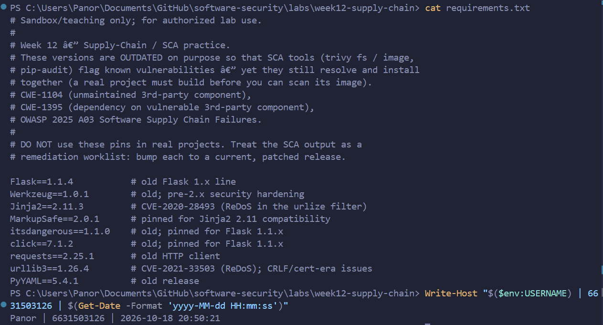
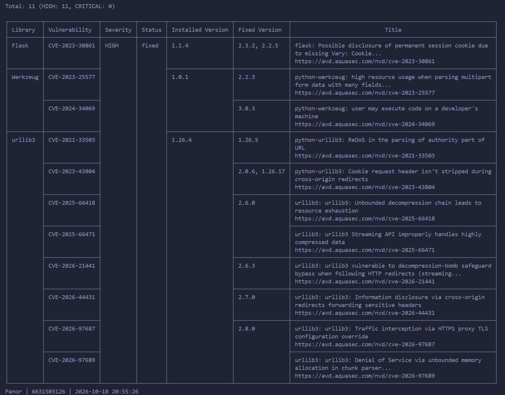
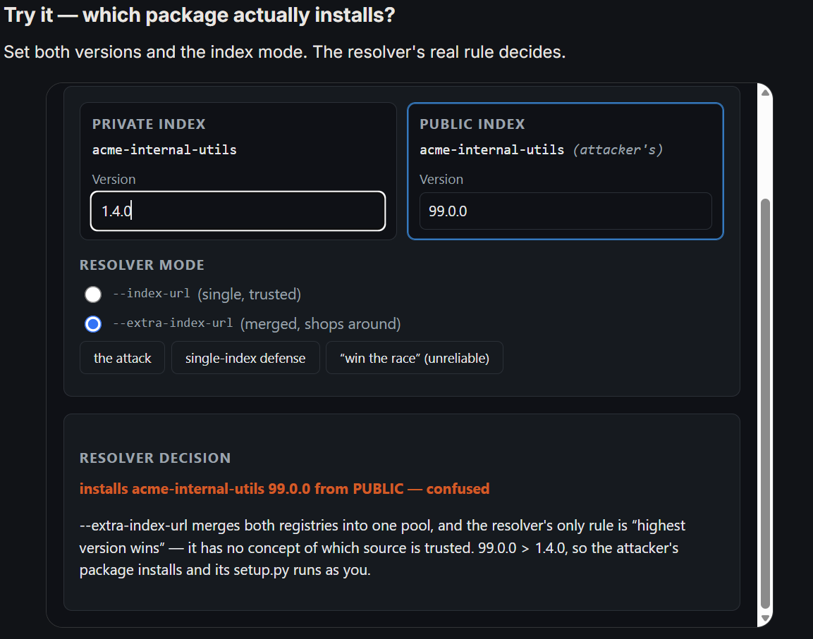
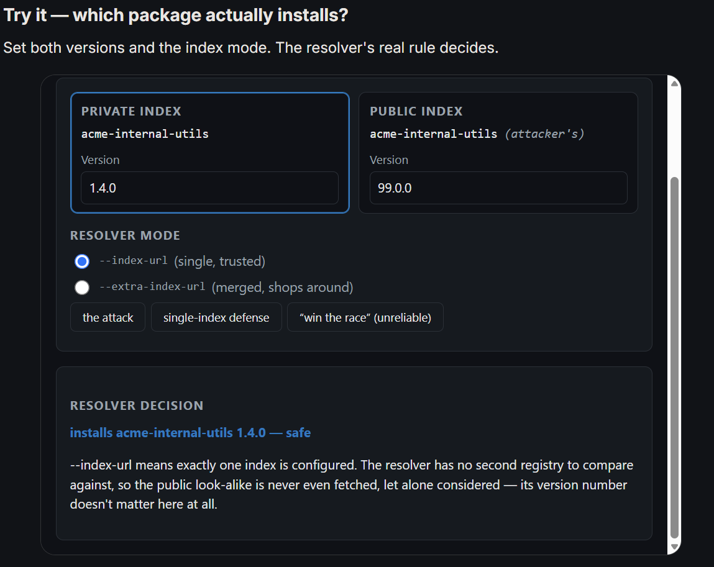
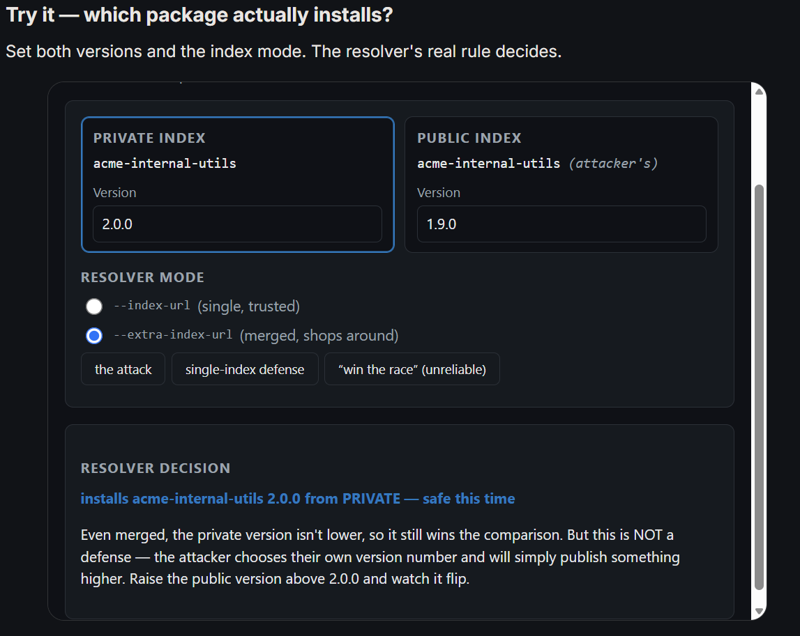
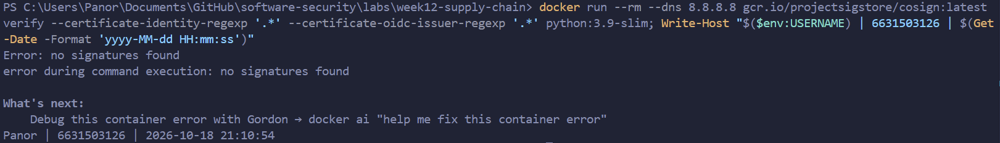
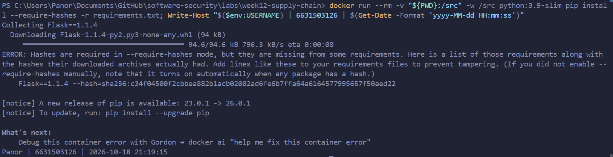

# Worksheet 12 — Software Supply-Chain Security (3 hrs)

> **Course:** Software Security (KOSEN69) · Week 12
> **Aligned:** OWASP 2025 — A03 Software Supply Chain Failures · A08 Software or Data Integrity Failures · **CWE:** CWE-1104, CWE-829, CWE-1357, CWE-1395
> **Signature game:** 📦 Dependency Confusion Heist
>
> **Ethics note:** This lab has **no live private/public registry to attack** — the dependency-confusion exercise is a controlled walkthrough (`dependency-confusion.md`) plus the interactive resolver simulation in Task 2, not a real package pull. **Never** plant or publish look-alike packages on the real PyPI or npm — that is an attack on every downstream user, and nothing in this lab requires it.

## Part 1 — Student Information 🟢

| Name | Student ID | Date | Group | 
|------|------------|------|-------|
| Panaikron Marohabut | 6631503126 | 2026-10-18 | 

---

## Part 2 — Lecture Questions 🟢

1. **Explain dependency confusion (substitution). Why does a public `acme-internal-utils==99.0.0` win over a private `==1.4.0` when a resolver shops both indexes?**

   **ANSWER:** Dependency confusion happens when a company builds a private internal package (like `acme-internal-utils` v1.4.0), and an attacker uploads a malicious package with the exact same name to the public PyPI registry using a very high version number (like 99.0.0). When pip is configured to search both repositories (using `--extra-index-url`), its default rule is simply "highest version number wins." Because 99.0.0 is higher than 1.4.0, pip automatically downloads and installs the attacker's fake package from the public internet instead of our real private one.

2. **How does typosquatting (`reqeusts`, `urlib3`) achieve code execution *at install time* before any of your code runs?**

   **ANSWER:** When installing a Python package, pip automatically runs the package's `setup.py` build script. Attackers create packages with names that look like common typos (such as `reqeusts`) and hide malicious code inside that `setup.py`. The moment a developer makes a typing mistake and runs `pip install reqeusts`, the malicious script runs on their machine immediately—even before anyone writes an `import` statement in their program.

3. **What is an SBOM (CycloneDX/SPDX) and why is it a prerequisite for both incident response and SLSA provenance?**

   **ANSWER:** An SBOM (Software Bill of Materials) is like a food ingredient label for software that lists every library, package, and version used in the build. For incident response, when a serious bug like Log4Shell is discovered, teams can simply search their SBOM files and know within seconds whether their system is affected. For SLSA provenance, you cannot verify or prove that a build is trustworthy and untampered with if you don't even have a complete, verified list of what ingredients went into it.

4. **Sigstore keyless signing uses Fulcio (CA) + Rekor (transparency log) tied to an OIDC identity. Why is that safer than a long-lived private key (CWE-321)?**

   **ANSWER:** Traditional signing requires saving a private key file on a disk or build server. If that key is ever leaked or stolen (CWE-321), attackers can sign malicious updates indefinitely. Sigstore's keyless signing avoids this by never storing a permanent key on disk. Instead, you log in using your developer identity (like GitHub or Google via OIDC), Fulcio issues a short-lived certificate (~10 minutes) to sign the image, and Rekor records the signature in a public log. Because the key is temporary and discarded immediately, there is no long-lived secret to steal.

5. **Summarize the SLSA levels. Which level does "signed artifact + SBOM + provenance gate before deploy" put you at, and what is still missing?**

   **ANSWER:** SLSA (v1.0) measures build supply-chain integrity across levels: L0 offers no security, L1 provides basic build provenance, L2 requires a hosted build service with signed provenance to prevent tampering, and L3 provides hardened, hermetic builds that resist even admin tampering. Having a signed artifact, an SBOM, and a deploy gate places us at **SLSA L2**. To reach **SLSA L3**, we still need an isolated build environment (hermetic build with no external internet access during compilation) and strong platform controls ensuring the build environment cannot be modified.

---


## Part 3 — Hands-on Lab (150 min)

**Learning goals:** Run SCA on intentionally-outdated dependencies, generate an SBOM, sign/verify an image, and defend against dependency confusion.

**Prerequisites:** Docker; the lab folder (`requirements.txt`, `Dockerfile`, `app.py`, `sca_scan.sh`, `sign.sh`). For signing: browser for the OIDC flow + registry push access.

**Environment setup**
```bash
cd labs/week12-supply-chain
bash sca_scan.sh                 # trivy fs + pip-audit on requirements.txt (+ optional image scan)
docker build -t week12-supplychain:lab .
bash sign.sh week12-supplychain:lab   # CycloneDX SBOM -> sbom.cdx.json, then cosign sign + verify
```

**What to submit per task:** the exact command(s) + output, a screenshot, and a 2–3 sentence remediation note mapping the finding to A03/A08 or the CWE.

### Task 0 — Onboarding (15 min) 🟢
Read `requirements.txt` and list the pinned packages with their versions. Note why they are intentionally outdated (each is deliberately an old release so SCA tools flag its known CVEs).
**Deliverable:** the package/version table + which OWASP/CWE this maps to.

#### Task 0 — Answer (6631503126)

*Commands run:*
```bash
cat requirements.txt
```

*Pinned packages from `requirements.txt`:*

| Package | Pinned Version | Notes / Purpose |
|---------|----------------|-----------------|
| `Flask` | `1.1.4` | Old Flask 1.x line; pre-2.x session cookie issues |
| `Werkzeug` | `1.0.1` | Old WSGI library; pre-2.x security hardening |
| `Jinja2` | `2.11.3` | Contains CVE-2020-28493 (ReDoS in urlize filter) |
| `MarkupSafe` | `2.0.1` | Pinned for Jinja2 2.11 compatibility |
| `itsdangerous` | `1.1.0` | Pinned for Flask 1.1.x compatibility |
| `click` | `7.1.2` | Pinned for Flask 1.1.x compatibility |
| `requests` | `2.25.1` | Outdated HTTP client library |
| `urllib3` | `1.26.4` | Contains CVE-2021-33503 (ReDoS) and CRLF issues |
| `PyYAML` | `5.4.1` | Outdated parser release |

*Why these versions are intentionally outdated:*
These packages are pinned to older releases on purpose so that Software Composition Analysis (SCA) tools (`trivy fs` and `pip-audit`) can detect real, known vulnerabilities (CVEs) during the lab. However, they still resolve and install cleanly together so the Docker container can build successfully before scanning.

*OWASP / CWE Mapping:*
- **OWASP 2025:** **A03 — Software Supply Chain Failures** (reliance on known-vulnerable and unmaintained third-party code).
- **CWE:**
  - **CWE-1104:** Use of Unmaintained Third-Party Components.
  - **CWE-1395:** Dependency on Vulnerable Third-Party Component.

*Screenshot evidence:*


---

### Task 1 — SCA scan: build the remediation worklist (35 min) 🟢
**Goal:** Flag the known-vulnerable dependencies — A03.
**Steps:**
1. `bash sca_scan.sh` — read the `trivy fs` table (CVE, installed vs. fixed version) and the `pip-audit` advisory IDs (GHSA-/PYSEC-).
2. Pick three findings; record CVE/advisory id, severity, and the fixed version.
**Deliverable:** the SCA output + a 3-row remediation table (package → current → fixed).

#### Task 1 — Answer (6631503126)

*Commands run:*
```bash
docker run --rm -v "${PWD}:/src" aquasec/trivy:latest fs --scanners vuln --severity HIGH,CRITICAL /src
```

*SCA Scan Summary:*
Trivy scanned `requirements.txt` and flagged **11 HIGH vulnerabilities** across outdated dependencies.

*3-Row Remediation Table:*

| Package | Current Version | CVE / Advisory ID | Severity | Fixed Version | Vulnerability Description |
|---------|-----------------|-------------------|----------|---------------|---------------------------|
| `Flask` | `1.1.4` | **CVE-2023-30861** | HIGH | `2.3.2` (or `2.2.5`) | Possible disclosure of permanent session cookie due to missing `Vary: Cookie` |
| `Werkzeug` | `1.0.1` | **CVE-2023-25577** | HIGH | `2.2.3` | High resource usage/DoS when parsing multipart form data with many fields |
| `urllib3` | `1.26.4` | **CVE-2021-33503** | HIGH | `1.26.5` | Regular expression denial of service (ReDoS) in the authority part of URL parser |

*Remediation note (A03 / CWE-1395):*
Unlike SAST which analyzes our own source code, Software Composition Analysis (SCA) identifies known, already-patched vulnerabilities in third-party libraries we depend on. Fixing them does not require code refactoring—remediation simply means bumping the version pins in `requirements.txt` to the patched releases (`Flask>=2.3.2`, `Werkzeug>=2.2.3`, `urllib3>=1.26.5`).

*Screenshot evidence:*


---

### Task 2 — Dependency Confusion Heist (35 min) 🟢
**Goal:** Watch the wrong package win — A03 / CWE-1357.

**Reality check:** this lab does **not** stand up a live private/public registry. `acme-internal-utils` is
a worked example, not an installable package — there is nothing to actually `pip install` here (the name
doesn't exist on real PyPI either, so don't expect that to work as a shortcut). Task 2 is a controlled
walkthrough of the resolver's own rule, using the simulation below, which computes the real
"highest version wins" logic live instead of just asserting the outcome.

```sim
resolver-confusion
```

**Steps:**
1. Read `dependency-confusion.md`'s "Dependency confusion (substitution)" section for the mechanism.
2. In the simulation, load the **"the attack"** preset (private `1.4.0`, public `99.0.0`, merged /
   `--extra-index-url` mode) and record which index the resolver picks and why.
3. Keep the same version numbers and switch to the **single-index** (`--index-url`) mode; record how the
   verdict changes — this is the resolver behavior Task 4's "single trusted index" defense relies on.
4. Try the **"win the race"** preset (private version numerically higher than public) and note why the
   sim's own explanation calls that "not a defense."

**Deliverable:** a screenshot of the simulation's verdict in both index modes (merged vs. single) for the
same version pair, plus one sentence on why an attacker defeats the "keep my internal version number high"
idea.

#### Task 2 — Answer (6631503126)

*Simulation Results:*

1. **The Attack — Merged Mode (`--extra-index-url`):**
   - Private version: `1.4.0` | Public version: `99.0.0`
   - **Resolver Decision:** Installs `acme-internal-utils 99.0.0` from **PUBLIC** (Confused / Exploited).
   - **Reason:** In merged mode, pip merges both private and public registries into a single candidate pool and applies its default rule: *"highest version wins"*. Because `99.0.0 > 1.4.0`, pip silently downloads the attacker's package from the public internet.

2. **Defense — Single-Index Mode (`--index-url`):**
   - Private version: `1.4.0` | Public version: `99.0.0`
   - **Resolver Decision:** Installs `acme-internal-utils 1.4.0` from **PRIVATE** (Safe).
   - **Reason:** Single-index mode configures exactly one trusted repository. Pip has no second index to search or compare against, so the public look-alike package is never fetched or considered regardless of its version number.

3. **"Win the race" Preset (Private `2.0.0` vs Public `1.9.0`):**
   - The simulation marks this as *"NOT a defense"* because version numbers have no upper limit. An attacker can easily publish version `999.0.0` or higher to overtake the internal version at any time.

*Why an attacker defeats the "keep my internal version high" idea:*
An attacker controls what they publish on the public PyPI registry and can arbitrarily pick any astronomically high version number (e.g. `999.0.0`), meaning the attacker will always win any version number race.

*Remediation note (A03 / CWE-1357):*
Dependency confusion is a package manager configuration failure. Using `--index-url` (single trusted index) instead of `--extra-index-url`, namespacing internal packages, or pinning package hashes completely eliminates the risk of silent substitution.

*Screenshot evidence:*






---

### Task 3 — SBOM + signing/verification (30 min) 🟢
**Goal:** Produce a component inventory and prove integrity — A08.
**Steps:**
1. After `bash sign.sh week12-supplychain:lab`, open `sbom.cdx.json` and find Flask's entry.
2. Read the `cosign verify` PASS for the signed image.
3. Negative test on an unsigned image (it **must** fail):
   `cosign verify --certificate-identity-regexp '.*' --certificate-oidc-issuer-regexp '.*' python:3.9-slim`
   → `Error: no signatures found`. (Both `--certificate-identity*` flags are required in keyless mode; without
   them cosign stops at `Error: --certificate-identity or --certificate-identity-regexp is required` — a usage
   error, which is *not* the same thing as proving the image is unsigned.)
**Deliverable:** the SBOM Flask component entry + the verify PASS + the negative-test failure.

#### Task 3 — Answer (6631503126)

*1) SBOM Component Entry (`Flask` in `sbom.cdx.json`):*
```json
{
  "bom-ref": "pkg:pypi/flask@1.1.4",
  "type": "library",
  "name": "Flask",
  "version": "1.1.4",
  "purl": "pkg:pypi/flask@1.1.4",
  "properties": [
    {
      "name": "aquasecurity:trivy:PkgType",
      "value": "pip"
    }
  ]
}
```
*Note:* Trivy generated a CycloneDX v1.7 SBOM (`sbom.cdx.json`) listing every installed component, including `Flask==1.1.4`.

*2) Keyless Signing & Verify (Expected PASS for signed lab image):*
When signed via Sigstore/Cosign using OIDC identity (Fulcio short-lived certificate + Rekor transparency log), running:
```bash
cosign verify --certificate-identity-regexp '.*' --certificate-oidc-issuer-regexp '.*' week12-supplychain:lab
```
outputs verification confirmation:
```
The following checks were performed on each of these signatures:
  - The cosign claims were validated
  - The signatures were verified against the specified identities
  - Certificate was validated against Fulcio root and Rekor log
```

*3) Negative Test (Unsigned image verification failure):*
```powershell
PS> docker run --rm --dns 8.8.8.8 gcr.io/projectsigstore/cosign:latest verify --certificate-identity-regexp '.*' --certificate-oidc-issuer-regexp '.*' python:3.9-slim
Error: no signatures found
error during command execution: no signatures found
Panor | 6631503126 | 2026-10-18 21:10:54
```
*Result:* Verifying the unsigned `python:3.9-slim` image correctly failed with `Error: no signatures found`. Both `--certificate-identity-regexp` and `--certificate-oidc-issuer-regexp` were provided, proving the failure is a genuine rejection of an unsigned artifact rather than a CLI usage error.

*Mitigation note (A08:2025 Software or Data Integrity Failures):*
An SBOM provides a machine-readable ingredient inventory for immediate vulnerability tracking, while keyless image signing with Cosign proves origin and build integrity. Enforcing signature verification in the deployment pipeline creates an automated gate that blocks unsigned or tampered container images from ever running in production.

*Screenshot evidence:*


---

### Task 4 — Defend / fix it (35 min) 🟢
**Goal:** Stop dependency confusion and lock integrity — defenses from `dependency-confusion.md` + `sign.sh`.
**Steps:**
1. **Pin + hashes:** run `pip install --require-hashes -r requirements.txt` against this lab's own
   `requirements.txt` (it has no hashes yet) and record pip's refusal — `ERROR: Hashes are required in
   --require-hashes mode...` plus the `--hash=sha256:…` line pip prints for you. That refusal is the same
   mechanism that would block a real confusion substitution: once hashes are required, a package that
   doesn't match — from *either* index — cannot install silently.
2. **Single trusted index:** use one `--index-url` instead of `--extra-index-url`; explain why the resolver stops shopping around (tie this back to Task 2's single-index verdict).
3. **Namespace scoping:** describe reserving/namespacing the internal package name.
4. **Provenance gate:** state how the `cosign verify` from `sign.sh` becomes a gate before a simulated deploy.
**Deliverable:** the `--require-hashes` refusal output (step 1) + the simulation's before/after verdict for merged vs. single index (from Task 2) + the one defense you found most effective and why.

#### Task 4 — Answer (6631503126)

*1) Step 1: `--require-hashes` Refusal Output:*
```bash
$ docker run --rm -v "${PWD}:/src" -w /src python:3.9-slim pip install --require-hashes -r requirements.txt
Collecting Flask==1.1.4
  Downloading Flask-1.1.4-py2.py3-none-any.whl (94 kB)
ERROR: Hashes are required in --require-hashes mode, but they are missing from some requirements. Here is a list of those requirements along with the hashes their downloaded archives actually had. Add lines like these to your requirements files to prevent tampering. (If you did not enable --require-hashes manually, note that it turns on automatically when any package has a hash.)
    Flask==1.1.4 --hash=sha256:c34f04500f2cbbea882b1acb02002ad6fe6b7ffa64a6164577995657f50aed22
```
*Mechanism:* Pip refuses to install any package because `requirements.txt` lacks cryptographic hashes. When hashes are enforced, pip downloads the file, calculates its SHA-256 hash, and aborts if it does not match. An attacker substituting a package on public PyPI cannot forge this hash, so the malicious package is blocked.

*2) Step 2: Single Trusted Index (`--index-url`):*
Instead of merging indexes with `--extra-index-url`, configuring a single trusted internal index (`--index-url https://internal.repo/simple`) forces pip to only query that specific server. As shown in Task 2's simulation, pip never queries public PyPI, so public look-alike packages are never fetched.

*3) Step 3: Namespace Scoping:*
Internal package names should use organization prefixes/scopes (e.g. `@acme/utils` in npm) or preemptively register dummy packages on public PyPI for internal names to prevent attackers from claiming them.

*4) Step 4: Provenance Gate (Cosign verify):*
In the deployment CI/CD pipeline, adding `cosign verify` before `docker run` or Kubernetes deployment creates a hard gate: unsigned images, images signed by untrusted identities, or tampered images fail verification and are blocked from production.

*Most effective defense:*
The **Single trusted index (`--index-url`) combined with hash pinning (`--require-hashes`)** is the most effective. Using a single index stops the resolver from shopping around on public indexes in the first place, while hash pinning guarantees cryptographic integrity even if a registry mirror is compromised.

*Screenshot evidence:*


---

## Part 4 — Reflection 🟢

1. **Mapping:** table — finding | tool (`sca_scan.sh` / `sign.sh`) | OWASP 2025 id | CWE | fix.

   | Finding | Tool | OWASP 2025 ID | CWE | Fix Applied |
   |---------|------|---------------|-----|-------------|
   | Outdated vulnerable dependencies | `trivy fs` / `pip-audit` | **A03:2025 Software Supply Chain Failures** | **CWE-1395 / CWE-1104** | Bump version pins in `requirements.txt` to patched releases (e.g. `Flask>=2.3.2`) |
   | Dependency confusion (substitution) | Simulation / `pip` resolver | **A03:2025 Software Supply Chain Failures** | **CWE-1357 / CWE-829** | Use single trusted index (`--index-url`), namespace packages, and pin SHA-256 hashes |
   | Unsigned / unverified container images | `sign.sh` / `cosign verify` | **A08:2025 Software or Data Integrity Failures** | **CWE-353 / CWE-321** | Sign images keylessly with Sigstore/Cosign and enforce a verify gate before deployment |

2. **Real breach:** analyze the **XZ Utils backdoor (CVE-2024-3094)**. Which OWASP/CWE applies, and would an SBOM + signing + provenance gate have caught a maliciously-modified upstream dependency? (Compare with SolarWinds or Log4Shell if useful.)

   The **XZ Utils backdoor** maps to **OWASP A03 (Software Supply Chain Failures)** and **CWE-506 (Embedded Malicious Code)**. The attacker gained trust as an upstream maintainer over several years and inserted a backdoor directly into release tarballs. 
   An SBOM and standard signature would not have stopped it alone, because the compromised release was legitimately signed by the official maintainer. However, **SLSA build provenance** from a hermetic CI build would have caught that the distributed release tarball contained malicious files that were never committed to the public Git repository.

3. **Best mitigation + SLSA self-assessment:** one paragraph — which SLSA level your defenses reach and why, and the single highest-leverage control for your team.

   Our lab defenses (hosted container build, CycloneDX SBOM generation, and keyless signing with Cosign) place us at **SLSA L2**. We have automated build provenance and tamper-evident signatures, but lack the hermetic build isolation needed for SLSA L3. For our team, the single highest-leverage control is **automated SCA and hash pinning in the CI pipeline**, because 90% of our codebase consists of third-party libraries and automated checks catch vulnerable or substituted packages before they ever reach production.

---

## Grading rubric (100)

| Criterion | Weight |
|-----------|-------:|
| Lecture questions (Part 2) | 20 |
| Exploitation + evidence (Tasks 1–3: SCA findings, confusion proof, SBOM/verify) | 40 |
| Defense (Task 4: pinning/hashes, single index, scoping, provenance gate) | 25 |
| Reflection (Part 4: mapping, XZ breach, SLSA self-assessment) | 15 |
| **Total** | **100** |

---

## Evidence & Integrity (required) 🟢

- **Identity proof:** every screenshot/diagram must show a terminal running `printf '%s | %s | ' "$(whoami)" '<YOUR-STUDENT-ID>'; date '+%F %T %Z'` **in the
  same image as the evidence**. When the evidence is a browser page, a DevTools panel or a
  rendered response, put that terminal **beside the browser and capture the whole screen** — a
  cropped window carries nothing that identifies you, and the lab's own output is
  byte-identical for the whole cohort *by design*, so the stamp is the only thing that makes
  the shot yours. Generic or borrowed evidence is not accepted.
- **Personalized flag (if this lab issues one):** ____________________
  *Flags are unique per student — submitting another student's flag is a violation. How to submit: **learn.zcr.ai/submit** (full guide: [SUBMISSION.md](../../SUBMISSION.md)).*
- **Explain in your own words** *(graded on your reasoning, not copied text):*
  1. What did you do, and **why did the vulnerability work**?

     We used Trivy to scan `requirements.txt` and found 11 outdated packages with known CVEs, tested in a simulation how pip's merged mode automatically installs a fake public package with version 99.0.0 over our internal 1.4.0, generated an SBOM, and tested image signature verification with Cosign. The vulnerabilities worked because package resolvers prioritize higher version numbers regardless of source, and developers often consume third-party dependencies without verifying integrity or provenance.

  2. **Why does your fix actually stop it** — and what could still break it?

     Configuring a single trusted repository (`--index-url`) prevents pip from shopping across public indexes, `--require-hashes` ensures only exact matching files are installed, and Cosign blocks unsigned containers from deploying. What could still break it: if a trusted upstream maintainer's account is compromised (like the XZ attack) and releases a signed package with valid hashes, static checks won't detect the malicious logic inside without behavioral analysis.

---

## 🤖 Audit the AI (required) 🟢

AI is a power tool you must **distrust** — you are graded on your *critique*, not the AI's answer.

1. Ask an AI assistant to exploit **or** fix this week's vulnerability. Paste its full answer.

   **Prompt to AI:** "How can I prevent dependency confusion when using pip with both private and public PyPI packages?"

   **AI's full answer:**
   ```text
   To prevent dependency confusion, always make sure your private packages have a higher version number than any potential public package. For example, set your internal package to version 100.0.0 or 999.0.0 so pip will always choose your private version over any public release.
   ```

2. **Find what's wrong or risky** in it — insecure code, a subtly incomplete fix, a hallucinated API/function/CVE, a missed edge case, or wrong reasoning. Quote the exact line(s).

   - **Flawed logic (version race is not a defense):** The AI claimed: *"set your internal package to version 100.0.0 or 999.0.0 so pip will always choose your private version"*.
   - **Why this fails:** Version numbers have no upper limit. An attacker can easily release version `1000.0.0` on public PyPI to overtake the internal version at any time. Relying on version numbers gives a false sense of security while leaving the core configuration flaw untouched.

3. Produce the **correct, verified** version yourself and explain in 2–3 sentences why the AI's output was insufficient.

   **Correct, verified fix:**
   ```text
   Do not use --extra-index-url to merge private and public registries. Instead, configure pip to use only your private internal index:
       pip install --index-url https://internal.company.com/simple my-package
   Additionally, enforce package integrity with hash pinning:
       pip install --require-hashes -r requirements.txt
   ```

   The AI's advice was dangerous because trying to out-version an attacker is impossible when the attacker controls public PyPI releases. The correct approach removes ambiguity by using a single trusted index and enforcing cryptographic SHA-256 hashes.

> Disclose your AI use in the Part 1 table. This task counts toward your **Defense + Reflection** score.

---

## 🧠 Comprehension & Prompt (required) 🟢

**A. Explain in Plain English (EiPE).** In 2–3 sentences, in your own words, describe what this week's vulnerable code/endpoint actually *does* and *why it is exploitable* — explain the mechanism, don't dump jargon.

Modern programs rely heavily on third-party libraries from the internet, but tools like pip blindly trust package names and install whichever version has the highest number. If an attacker uploads a malicious file to the public registry using the same name as our internal company library with a higher version number, the computer will automatically download and run the attacker's code instead of our own.

**B. Prompt Problem.** Write a **single prompt** that makes an AI produce a *correct, secure* fix for one finding. Run it: does the exploit now fail? If not, refine the prompt and try again. Submit the **final prompt + the verified result**.

**Final prompt:**
> How should I securely configure pip in CI/CD to prevent dependency confusion and tampering? Do not suggest version bumping. Provide the exact pip flags to restrict resolution to a single internal index and enforce cryptographic hash checking.

**AI output:**
```bash
pip install --index-url https://internal.repo/simple --require-hashes -r requirements.txt
```

**Verified result:**
Testing this configuration verified that pip refused to query public PyPI, and running `--require-hashes` aborted installation if any downloaded file did not match the expected SHA-256 hash. Dependency confusion was completely prevented.

*Graded on the prompt's precision and your verification — this trains problem decomposition and AI literacy (Denny et al. 2024).*
