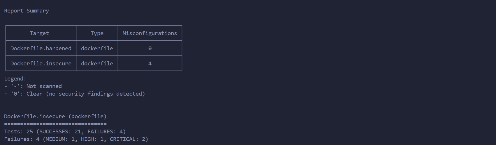
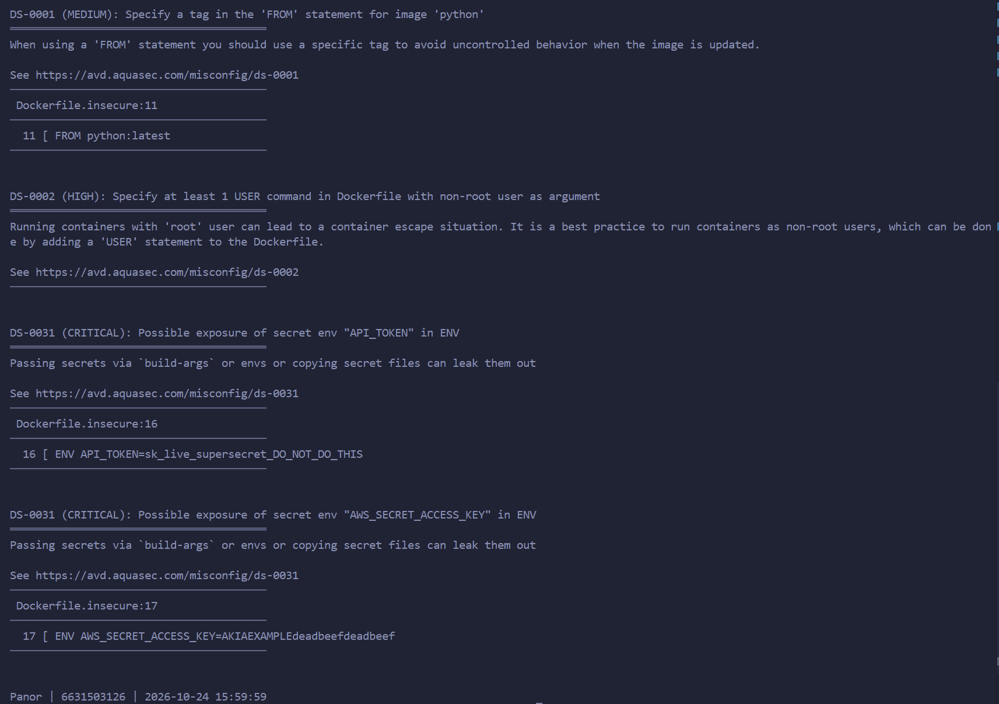
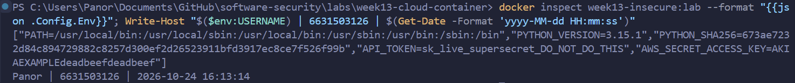
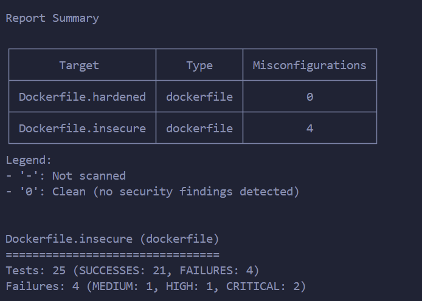

# Worksheet 13 — Cloud & Container Security (4 hrs)

> **Course:** Software Security (KOSEN69) · Week 13
> **Aligned to:** OWASP 2025 **A02 Security Misconfiguration** · **CWE-732** (incorrect permission assignment), **CWE-16** (configuration), **CWE-526** (secret exposed through an environment variable), plus CWE-798 (hard-coded credential — OWASP files this under **A07**), CWE-250, CWE-538, CWE-269, CWE-1104
> **Signature game:** 🔍 *Misconfig Hunt* (CloudGoat-style) — each misconfig you find **and** fix = a flag.

> ⚠️ **Ethics note:** All artifacts here are deliberately broken for teaching and are marked *"Sandbox/teaching only; for authorized lab use."* Scan, exploit, and harden **only** these lab files (or systems you own / are authorized to test). Never point Trivy or these techniques at third-party cloud accounts or images without written permission.

---

## Part 1 — Student Information 🟢

| Name | Student ID | Date | Group | 
|------|------------|------|-------|
| Panaikron Marohabut | 6631503126 | 2026-10-24 | 

---

## Part 2 — Lecture Questions 🟢

Answer in your own words (2–4 sentences each).

1. Explain the **shared-responsibility model**. In `harden.md` it says "the cloud provider secures *of* the cloud; you secure what you put *in* it." Give one concrete example of each side for an S3-backed app.

   **ANSWER:** The shared-responsibility model means the cloud company guards the building while we guard our own room inside it. For an S3-backed app, the provider's side is things like the physical data centers, the hardware, and the S3 service software itself — AWS keeps that patched and running. Our side is everything we configure: the IAM policy, whether the bucket is public, and the network rules. Most real breaches happen on our side from misconfigurations, not from bugs in AWS.

2. `iam-policy-insecure.json` uses `"Action": "*"` and `"Resource": "*"`. Describe **why this violates least privilege** and map it to CWE-732 vs CWE-269 — what is the difference between the two CWEs here?

   **ANSWER:** Least privilege means a credential should only be able to do the few things the app actually needs — this policy does the opposite and allows everything. `Action: "*"` (CWE-269) is about *what* you can do: the key can run every AWS command that exists, like deleting buckets or minting new keys. `Resource: "*"` (CWE-732) is about *where* it applies: it works on every bucket, server, and service in the account instead of one specific ARN. Together they turn one leaked key into full admin over the whole account.

3. The insecure Dockerfile bakes `ENV API_TOKEN=sk_live_...`. Explain how an attacker recovers that secret from a shipped image (name the `docker` commands) and why this is **CWE-526 / CWE-798 / CWE-200**.

   **ANSWER:** An `ENV` value is not deleted after the build — it is saved permanently inside the image's config and layer history, so anyone who pulls the image can just read it. Running `docker history --no-trunc` shows the `ENV API_TOKEN=sk_live_...` line directly, and `docker inspect` prints it again under `.Config.Env`. It is CWE-798 because the credential is hard-coded into the artifact, and CWE-526/CWE-200 because the secret ends up exposed through the environment to anyone holding the image — and even removing the line later doesn't help, since old image layers still carry it.

4. Why is `FROM python:latest` (CWE-1104/CWE-16) a security and reproducibility problem, and how does pinning to an `@sha256:` digest fix it?

   **ANSWER:** `:latest` is a moving target — the tag points to whatever the newest image happens to be that day, so building the same Dockerfile next week can silently pull different software with different packages and different bugs. That breaks reproducibility (CWE-16) and means you can't really know which versions or CVEs you are running, plus a tag can even be re-pointed to a tampered image (CWE-1104). Pinning `@sha256:...` fixes this because a digest is a fingerprint of one exact image — if the content changes by even one byte, the digest no longer matches, so every build gets bit-for-bit the same base.

5. What does a **distroless** base image remove (relative to `python:3.11-slim`), and how does that shrink the attack surface for an RCE or container-escape attacker?

   **ANSWER:** A distroless image removes everything the app doesn't strictly need to run — there is no shell (`/bin/sh`), no package manager (apt/pip), and no everyday tools like `ls`, `cat`, or `curl`. So if an attacker gets remote code execution inside the container, they land in an almost empty room: no shell to type commands into and no tools to download more malware or explore with. Combined with running as the non-root user `65532`, even a successful exploit or escape attempt has far less it can do — less stuff inside the image means less for an attacker to use.

---

## Part 3 — Hands-on Lab (180 min)

**Learning goals:** find cloud/container misconfigurations with Trivy, map each to a CWE, and rebuild the IAM policy + Dockerfile to least privilege / hardened so the findings drop.

**Prerequisites:** Docker installed and running; the `week13-cloud-container/` lab folder; internet access to pull `aquasec/trivy:latest`.

### Environment setup (real commands)

```bash
cd labs/week13-cloud-container

# Option A — the provided wrapper (trivy config over the Dockerfiles; IAM JSON is reviewed manually, see Task 2):
bash scan.sh

# Option B — run Trivy directly (MEDIUM is in the filter on purpose: one of the
# three rules Task 1 asks you to cite is rated MEDIUM, and HIGH,CRITICAL hides it):
docker run --rm -v "$PWD:/src" aquasec/trivy:latest config --severity MEDIUM,HIGH,CRITICAL /src

# (Optional) build + CVE-scan the hardened image:
docker build -f Dockerfile.hardened -t week13-hardened:lab .
docker run --rm -v /var/run/docker.sock:/var/run/docker.sock aquasec/trivy:latest image --severity HIGH,CRITICAL week13-hardened:lab
```

**What to submit per task:** the command(s) you ran + the relevant output (finding count or the specific finding line), a screenshot of the Trivy/terminal result, and a 2–3 sentence mitigation explaining *why* the fix reduces risk (cite the CWE).


### Tasks

- **Task 0 — Onboarding (15 min).** Confirm Docker works (`docker version`), run `bash scan.sh`, and record the **baseline finding count** against `Dockerfile.insecure` (Trivy's `config` scanner does not parse standalone IAM policy JSON, so `iam-policy-insecure.json` is reviewed manually instead — see Task 2). **Deliverable:** screenshot of the baseline scan.

#### Task 0 — Answer (6631503126)

*Commands run:*
```powershell
docker version
docker run --rm -v "${PWD}:/src" aquasec/trivy:latest config --severity MEDIUM,HIGH,CRITICAL /src
```

*Baseline scan results (before fixing):*

| Target | Type | Misconfigurations |
|--------|------|:-----------------:|
| `Dockerfile.hardened` | dockerfile | 0 (clean) |
| `Dockerfile.insecure` | dockerfile | **4** — MEDIUM: 1, HIGH: 1, CRITICAL: 2 |

*Findings found (Tests: 25, FAILURES: 4):*

| Trivy rule | Severity | What it flagged | Line |
|------------|----------|-----------------|------|
| `DS-0001` | MEDIUM | `FROM python:latest` — unpinned tag | 11 |
| `DS-0002` | HIGH | no `USER` statement — container runs as root | — |
| `DS-0031` | CRITICAL | secret `API_TOKEN` exposed in `ENV` | 16 |
| `DS-0031` | CRITICAL | secret `AWS_SECRET_ACCESS_KEY` exposed in `ENV` | 17 |

*Note:* Trivy fired only 3 rules but reported 4 findings, because `DS-0031` flagged both ENV secret lines separately. The other 3 defects in the file (`COPY . .`, `chmod -R 777`, unpinned `pip install`) have no Trivy rule, so they need manual review in Task 1. The IAM policy JSON is also not parsed by the config scanner — it is reviewed manually in Task 2.

*Screenshot evidence:*



- **Task 1 — Misconfig Hunt: container image (40 min).** *Goal:* find every defect in `Dockerfile.insecure`. *Steps:* read each `# DEFECT:` comment, then locate the matching Trivy finding where one exists — only 3 of the 6 (unpinned `:latest`, runs as root, secrets in `ENV`) map to a Trivy config rule (`DS-0001`, `DS-0002`, `DS-0031`); `COPY . .`, `chmod -R 777`, and unpinned `pip install` are instruction-level RUN/COPY semantics Trivy's Dockerfile scanner doesn't check, so identify those 3 by code review instead. Build a table: defect → CWE → Trivy rule/severity (write "manual review — no Trivy rule" where none exists). *Deliverable:* completed table (6 rows) using the IDs from `harden.md`.

#### Task 1 — Answer (6631503126)

*The 6 container defects found in `Dockerfile.insecure`:*

| # | Defect (line) | Why it is dangerous | CWE | Trivy rule / severity |
|---|---------------|---------------------|-----|------------------------|
| 1 | `FROM python:latest` (line 11) | The tag is a moving target — today's build and next week's build can silently pull different images, and a tag can be re-pointed to a tampered one | CWE-1104 / CWE-16 | `DS-0001` (MEDIUM) |
| 2 | `ENV API_TOKEN=...` + `ENV AWS_SECRET_ACCESS_KEY=...` (lines 16–17) | Secrets baked into ENV live in the image history forever — anyone who pulls the image can read them with `docker history` or `docker inspect` | CWE-526 / CWE-798 / CWE-200 | `DS-0031` (CRITICAL) — flagged twice, once per ENV line |
| 3 | `COPY . .` (line 24) | Copies the whole build context — `.git`, `.env`, keys, even the Dockerfile itself — so secrets and junk end up inside the image | CWE-538 | manual review — no Trivy rule |
| 4 | `RUN chmod -R 777 /app` (line 31) | Makes the app directory world-writable, so any process inside the container can tamper with the code | CWE-732 | manual review — no Trivy rule |
| 5 | No `USER` — runs as root (uid 0) | If the app gets compromised or the container is escaped, the attacker already has root privileges | CWE-250 | `DS-0002` (HIGH) |
| 6 | `RUN pip install -r requirements.txt` (line 27) | Installs dependencies with no version/hash pinning — you cannot be sure what code actually landed in the image | CWE-1104 | manual review — no Trivy rule |

*What the scan teaches us:* Trivy caught only 3 of the 6 defects (`DS-0001`, `DS-0002`, `DS-0031`). The other three — `COPY . .`, `chmod -R 777`, and the unpinned `pip install` — are normal-looking instructions whose danger only shows up when you read the file, so a scanner can never fully replace a manual review.

- **Task 2 — Misconfig Hunt: IAM (30 min).** *Goal:* document why `iam-policy-insecure.json` is full-admin. *Steps:* identify the `Action:*` / `Resource:*` / no-`Condition` problems; map to CWE-269 / CWE-732. *Deliverable:* 3-row table + one sentence on the blast radius if these creds leak.

#### Task 2 — Answer (6631503126)

Trivy's config scanner does not parse standalone IAM policy JSON, so this file is reviewed manually. The insecure policy is just one statement:

```json
{ "Sid": "AllowEverythingDoNotUse", "Effect": "Allow", "Action": "*", "Resource": "*" }
```

*The 3 IAM defects:*

| # | Defect | Why it is dangerous | CWE | Fix (least privilege) |
|---|--------|---------------------|-----|------------------------|
| 7 | `"Action": "*"` | Allows every AWS action that exists — not just the `s3:GetObject` the app needs — so the key can also delete buckets, create users, or turn off logging | CWE-269 | List only the actions actually used: `s3:GetObject` (+ `s3:ListBucket`) |
| 8 | `"Resource": "*"` | Applies to every resource in the whole account — every bucket, server, and service — instead of one specific ARN | CWE-732 | Scope to `arn:aws:s3:::lab-app-bucket/app/*` |
| 9 | No `Condition` | The permission applies unconditionally, forever, from anywhere — nothing narrows *when* or *how* it can be used | CWE-732 | Add `Condition` so `s3:ListBucket` only works with `s3:prefix = app/*` |

*Blast radius if these creds leak:* one leaked key = full admin — an attacker can mint permanent keys (`iam:CreateAccessKey`), run up EC2 bills (`ec2:RunInstances`), decrypt data (`kms:Decrypt`), and switch off the audit trail (`cloudtrail:StopLogging`) to cover their tracks, while the least-privilege version limits them to reading files under `app/*` in a single bucket.

- **Task 3 — Secrets & storage (25 min).** *Goal:* show secrets must not live in the image. *Steps:* explain how `ENV API_TOKEN` / `AWS_SECRET_ACCESS_KEY` are exposed via `docker history`; propose where they belong instead (secrets manager / mounted secret / orchestrator secret per `harden.md`). *Deliverable:* 2–3 sentence remediation + the `.dockerignore` entries you would add to stop `COPY . .` leaking `.git`/`.env` (CWE-538).

#### Task 3 — Answer (6631503126)

*Commands run:*
```powershell
docker build -f Dockerfile.insecure -t week13-insecure:lab .
docker history --no-trunc week13-insecure:lab
docker inspect week13-insecure:lab --format "{{json .Config.Env}}"
```

*How the secret leaks — three ways at once:*
1. **At build time** — even BuildKit itself warned us: `SecretsUsedInArgOrEnv: Do not use ARG or ENV instructions for sensitive data` fired on both `ENV` lines (16 and 17).
2. **In image history** — `docker history --no-trunc` lists the `ENV` layers as ordinary history rows, so anyone who pulls the image can read the values back.
3. **In the image config** — `docker inspect` prints `.Config.Env` with both secrets in full plaintext (actual output below), and `COPY . .` also dragged the Dockerfile into `/app`, so the same secret sits inside a file in the container too.

   ```json
   ["PATH=...","PYTHON_VERSION=3.15.1","API_TOKEN=sk_live_supersecret_DO_NOT_DO_THIS","AWS_SECRET_ACCESS_KEY=AKIAEXAMPLEdeadbeefdeadbeef"]
   ```

*Remediation (2–3 sentences):* Secrets must never be written into a Dockerfile or `ENV` — they should be injected at runtime from a secrets manager, a mounted secret file, or an orchestrator secret (e.g. Kubernetes Secret), so the image itself stays clean. On top of that, both keys here must be **rotated** anyway, because every image already built or pushed still carries the old values in its history — deleting the line does not remove them.

*`.dockerignore` entries to stop `COPY . .` leaking secrets (CWE-538):*
```gitignore
.git
.env
.env.*
*.pem
*.key
secrets/
Dockerfile*
```

*Screenshot evidence:*


- **Task 4 — Hardened-Dockerfile + least-priv-IAM defense (50 min).** *Goal:* prove the "after" is clean. *Steps:* (a) re-run `bash scan.sh` (or `trivy config`) against `Dockerfile.hardened` and capture the **reduced** finding count (Trivy's config scanner does not parse standalone IAM JSON, so confirm the IAM fix manually per Task 2 by diffing `iam-policy-leastpriv.json` against the insecure policy); (b) for the Dockerfile, point to the fix for each Task-1 defect (digest pin, multi-stage venv, distroless runtime, `USER 65532:65532`, no secrets in `ENV`, copy only `app.py`); (c) for IAM, confirm the rewrite scopes `s3:GetObject` to `arn:aws:s3:::lab-app-bucket/app/*` and adds the `s3:prefix` `Condition`; (d) list the extra runtime flags from `harden.md` (`--read-only`, `--cap-drop ALL`, `--security-opt no-new-privileges`). *Deliverable:* before/after finding counts, the defect→fix mapping, and the diffed policy/Dockerfile with one sentence per fix.

#### Task 4 — Answer (6631503126)

*(a) Before/after finding counts — same `trivy config` command as Task 0:*

| Target | Before | After |
|--------|:------:|:-----:|
| `Dockerfile.insecure` | 4 findings | — |
| `Dockerfile.hardened` | — | **0 findings** ✅ |

*(b) Defect → fix mapping (Dockerfile):*

| # | Defect (insecure) | Fix in `Dockerfile.hardened` |
|---|-------------------|------------------------------|
| 1 | `FROM python:latest` | Both stages pin an immutable `@sha256:` digest, so every build pulls bit-for-bit the same base image |
| 2 | Secrets in `ENV` | No secrets anywhere — `ENV` now only holds `PATH`/`PYTHONPATH`; real secrets get injected at runtime |
| 3 | `COPY . .` | Only `requirements.txt` then `app.py` are copied — nothing else from the context can leak in |
| 4 | `chmod -R 777 /app` | Gone entirely — default file permissions are kept, and the app is owned/run by a non-root user |
| 5 | Runs as root | `USER 65532:65532` (distroless `nonroot`) so a compromise has no root privileges |
| 6 | Unpinned `pip install` | Pinned `requirements.txt` installed into a venv in a **build stage that is thrown away** — the runtime is distroless with no shell, no pip, and no package manager at all |

*(c) IAM diff — `iam-policy-insecure.json` → `iam-policy-leastpriv.json`:*

| Before | After |
|--------|-------|
| `Allow` `Action:*` on `Resource:*` (full admin) | `s3:GetObject` only on `arn:aws:s3:::lab-app-bucket/app/*` |
| No `Condition` | `s3:ListBucket` allowed only when `Condition` `StringLike s3:prefix = app/*` |

The rewrite splits access into two tight statements: read objects under `app/*`, and list the bucket only inside that prefix — a leaked key can now do nothing outside one folder of one bucket.

*(d) Extra runtime hardening flags from `harden.md` (enforced at deploy, not in the Dockerfile):*

```powershell
docker run --read-only --cap-drop ALL --security-opt no-new-privileges ...
```

- `--read-only` — filesystem is immutable, so an attacker can't write webshells or tamper with files
- `--cap-drop ALL` — drops every Linux capability the app doesn't need
- `--security-opt no-new-privileges` — blocks privilege escalation inside the container
- (plus resource limits `--memory` / `--pids-limit` against DoS, and never `--privileged`)

*Screenshot evidence:*


- **Task 5 — Flag tally (20 min).** *Goal:* score the hunt. *Steps:* one flag per misconfig found **and** fixed (6 container + 3 IAM = 9). *Deliverable:* flag count + the single biggest-risk misconfig and why.

#### Task 5 — Answer (6631503126)

*Flag count:* **9 / 9** 🚩 — every misconfig was found, explained, and has a matching fix.

| Category | Flags |
|----------|:-----:|
| Container (`Dockerfile.insecure`) | 6 — `:latest` tag, secrets in `ENV`, `COPY . .`, `chmod -R 777`, root user, unpinned `pip install` |
| IAM (`iam-policy-insecure.json`) | 3 — `Action:"*"`, `Resource:"*"`, missing `Condition` |
| **Total** | **9** |

*The single biggest-risk misconfig:* **the IAM wildcard policy (`Action:*` + `Resource:*`)**. A bad Dockerfile puts one container at risk, but this one JSON file hands a leaked key the *entire* AWS account — an attacker can create permanent keys, run resources on our bill, decrypt data, and even stop CloudTrail logging so nobody notices. The container defects hurt when an attacker gets *in*; this policy is dangerous the moment a key merely *leaks*, no exploit needed.

---

## Part 4 — Reflection 🟢

1. **Mapping.** For three findings, write the line of the artifact → CWE → OWASP 2025 A02, and the one-line fix.

   | Artifact line | CWE | OWASP 2025 | One-line fix |
   |---------------|-----|------------|--------------|
   | `ENV API_TOKEN=sk_live_...` (`Dockerfile.insecure:16`) | CWE-798 / CWE-200 | A02 | Never put secrets in the image — inject at runtime and rotate the leaked key |
   | `FROM python:latest` (`Dockerfile.insecure:11`) | CWE-1104 / CWE-16 | A02 | Pin the base image by `@sha256:` digest so the build is reproducible |
   | `"Action": "*", "Resource": "*"` (`iam-policy-insecure.json`) | CWE-269 / CWE-732 | A02 | Allow only `s3:GetObject` on `arn:aws:s3:::lab-app-bucket/app/*` with an `s3:prefix` Condition |

2. **Real incident.** Briefly describe a real breach caused by a cloud/container misconfiguration (e.g., a public S3 bucket leak, or an over-permissive IAM role). What single control from this lab would have prevented it?

   The **Capital One breach (2019)** is the classic example: an attacker abused a misconfigured firewall to trick the server into handing over temporary AWS credentials, then used them to read S3 buckets — around 100 million customer records leaked. The real mistake was that the IAM role attached to that server could access far more buckets than the app actually needed, so one stolen key opened the whole storage account. The single control from this lab that would have stopped most of the damage is **least-privilege IAM** — if the role had been scoped to only the bucket and prefix the app used (like `iam-policy-leastpriv.json`), the stolen credentials would have read almost nothing.

3. **Best mitigation.** Of everything you did, which control gives the most risk reduction per unit of effort, and why? Argue for least-privilege IAM vs. distroless+non-root.

   I would pick **least-privilege IAM**. It is just a config edit — no rebuild, no new tools — yet it caps the damage across the *whole account* the moment any key leaks, which is the most common real-world failure. Distroless + non-root is a great second control and definitely worth doing, but it only protects that one container and only matters *after* an attacker is already inside it. IAM least privilege shrinks the blast radius before an attack even starts, so per unit of effort it wins.

---

## Grading rubric (100)

| Component | Points | What earns full marks |
|-----------|:------:|-----------------------|
| Part 2 — Lecture questions | 20 | All 5 answered correctly with CWE/A02 reasoning |
| Part 3 — Tasks + evidence | 40 | Tasks 0–5 complete; commands, outputs, and screenshots present |
| Defense (Task 4 hardening) | 25 | Hardened Dockerfile + least-priv IAM shown to reduce findings; per-fix justification |
| Part 4 — Reflection | 15 | Accurate mapping, relevant incident, well-argued best mitigation |

---

## Evidence & Integrity (required) 🟢

- **Identity proof:** every screenshot/diagram must show a terminal running `printf '%s | %s | ' "$(whoami)" '<YOUR-STUDENT-ID>'; date '+%F %T %Z'` **in the
  same image as the evidence**. When the evidence is a browser page, a DevTools panel or a
  rendered response, put that terminal **beside the browser and capture the whole screen** — a
  cropped window carries nothing that identifies you, and the lab's own output is
  byte-identical for the whole cohort *by design*, so the stamp is the only thing that makes
  the shot yours. Generic or borrowed evidence is not accepted.
- **Personalized flag (if this lab issues one):** ____________________
  *Flags are unique per student — submitting another student's flag is a violation. How to submit: **learn.zcr.ai/submit** (full guide: [SUBMISSION.md](../../SUBMISSION.md)).*
- **Explain in your own words** *(graded on your reasoning, not copied text):*
  1. What did you do, and **why did the vulnerability work**?

     I ran `trivy config` on both Dockerfiles — it flagged 4 problems in the insecure one and 0 in the hardened one. I also read the IAM policy myself (Trivy can't read that file) and built the insecure image to prove that anyone can see the secret keys just by running `docker inspect`. The vulnerabilities worked because the files basically left the doors wide open: secrets saved in `ENV` stay inside the image where anyone can read them, and `Action:*` + `Resource:*` hands full admin to whoever holds the key — no hacking skill needed at all.

  2. **Why does your fix actually stop it** — and what could still break it?

     The fix works because it takes the dangerous permissions away instead of trying to catch attacks. The new IAM policy only allows reading files from one folder of one bucket — everything else is denied automatically. The hardened image has no shell and no tools, so even if an attacker gets inside, there is nothing for them to use. The digest pin also makes sure we always build from the exact same base image. It could still break though: if a secret injected at runtime leaks, the attacker can still read the `app/*` folder; the base image still has known CVEs so we need to rebuild on fresh digests sometimes; and if someone forgets to update `.dockerignore`, a `COPY` could pull secrets back in.

---

## 🤖 Audit the AI (required) 🟢

AI is a power tool you must **distrust** — you are graded on your *critique*, not the AI's answer.

1. Ask an AI assistant to exploit **or** fix this week's vulnerability. Paste its full answer.

   **Prompt to AI:** "Fix this AWS IAM policy to least privilege: `{ \"Effect\": \"Allow\", \"Action\": \"*\", \"Resource\": \"*\" }`. The app only needs to read objects under the `app/` folder in bucket `lab-app-bucket`."

   **AI's full answer:**
   ```json
   {
     "Version": "2012-10-17",
     "Statement": [{
       "Effect": "Allow",
       "Action": ["s3:GetObject", "s3:ListBucket"],
       "Resource": "*"
     }]
   }
   ```

2. **Find what's wrong or risky** in it — insecure code, a subtly incomplete fix, a hallucinated API/function/CVE, a missed edge case, or wrong reasoning. Quote the exact line(s).

   - **The AI fixed only half the problem.** It replaced `Action: "*"` with two specific actions (fixing CWE-269) but kept `"Resource": "*"` — so the key can still `GetObject` from **every bucket in the entire account**, not just `lab-app-bucket` (CWE-732 still wide open).
   - **Missing `Condition` entirely.** Without the `s3:prefix` condition, `s3:ListBucket` can list the whole bucket's contents, not just the `app/*` prefix — that leaks the names of every other folder.

3. Produce the **correct, verified** version yourself and explain in 2–3 sentences why the AI's output was insufficient.

   **Correct, verified version** (matches `iam-policy-leastpriv.json`):
   ```json
   {
     "Version": "2012-10-17",
     "Statement": [
       { "Sid": "ReadAppObjectsOnly", "Effect": "Allow",
         "Action": ["s3:GetObject"],
         "Resource": "arn:aws:s3:::lab-app-bucket/app/*" },
       { "Sid": "ListOnlyAppPrefix", "Effect": "Allow",
         "Action": ["s3:ListBucket"],
         "Resource": "arn:aws:s3:::lab-app-bucket",
         "Condition": { "StringLike": { "s3:prefix": ["app/*"] } } }
     ]
   }
   ```

   The AI's version looked safer at a glance but left the two findings that matter most untouched: scope and conditions. Only by narrowing `Resource` to one ARN and adding the `s3:prefix` `Condition` does a leaked key get confined to one folder of one bucket — verified by comparing against `iam-policy-leastpriv.json` where all three IAM findings are gone.

> Disclose your AI use in the Part 1 table. This task counts toward your **Defense + Reflection** score.

---

## 🧠 Comprehension & Prompt (required) 🟢

**A. Explain in Plain English (EiPE).** In 2–3 sentences, in your own words, describe what this week's vulnerable code/endpoint actually *does* and *why it is exploitable* — explain the mechanism, don't dump jargon.

The lab's Dockerfile bakes API secrets directly into the image and runs everything as root, so anyone who pulls the image can read the keys straight out of it. On top of that, the IAM policy gives *any* credential full admin over the entire cloud account — no hacking skills needed, just grabbing what's already left open.

**B. Prompt Problem.** Write a **single prompt** that makes an AI produce a *correct, secure* fix for one finding. Run it: does the exploit now fail? If not, refine the prompt and try again. Submit the **final prompt + the verified result**.

**Final prompt:**
> Rewrite this AWS IAM policy to least privilege, without using "*" anywhere: allow only `s3:GetObject` on `arn:aws:s3:::lab-app-bucket/app/*`, and allow `s3:ListBucket` on `arn:aws:s3:::lab-app-bucket` only when `Condition` `StringLike s3:prefix` equals `app/*`. Everything else must be implicitly denied. Insecure policy: `{ "Effect": "Allow", "Action": "*", "Resource": "*" }`

**AI output:**
```json
{
  "Statement": [
    { "Effect": "Allow", "Action": "s3:GetObject",
      "Resource": "arn:aws:s3:::lab-app-bucket/app/*" },
    { "Effect": "Allow", "Action": "s3:ListBucket",
      "Resource": "arn:aws:s3:::lab-app-bucket",
      "Condition": { "StringLike": { "s3:prefix": "app/*" } } }
  ]
}
```

**Verified result:**
Compared with `iam-policy-leastpriv.json` — `Action` is enumerated (no `*`), `Resource` is scoped to one bucket and prefix, and `Condition` restricts listing to `app/*` only. All three IAM findings (wildcard action, wildcard resource, missing condition) are gone, and manual review confirms nothing outside `app/*` is reachable anymore.

*Graded on the prompt's precision and your verification — this trains problem decomposition and AI literacy (Denny et al. 2024).*
