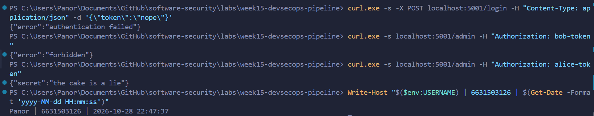
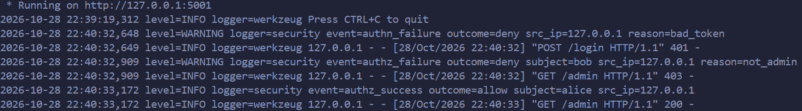
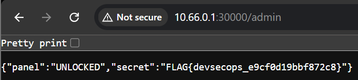
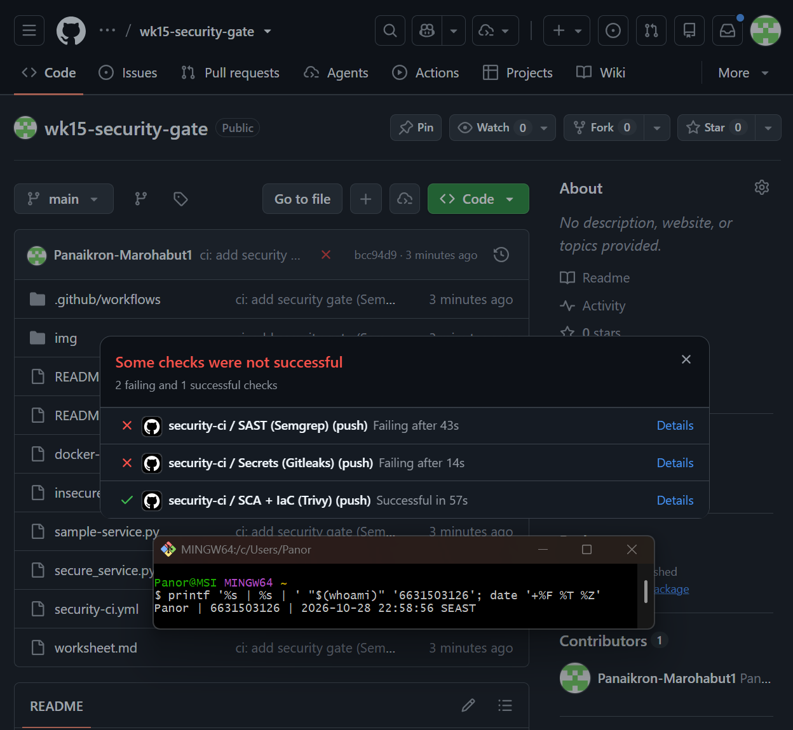
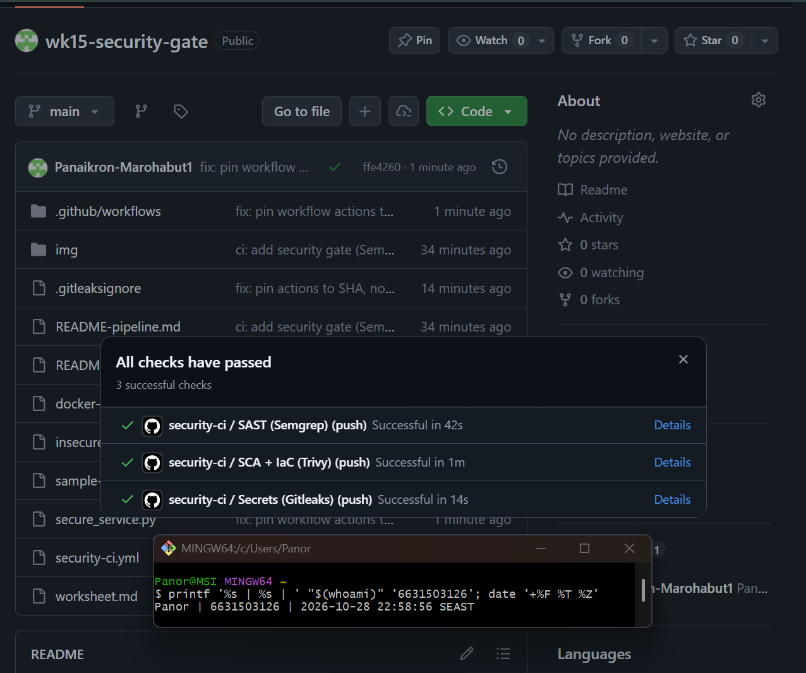
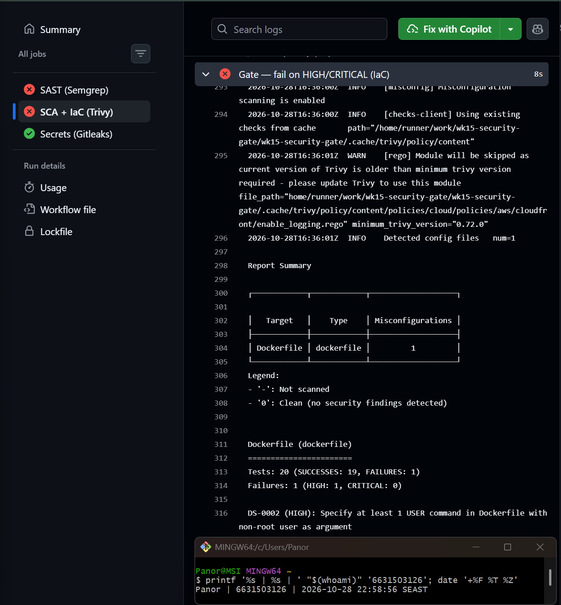

# Worksheet 15 — DevSecOps: Putting It Together (4 hrs)

> **Course:** Software Security (KOSEN69) · Week 15
> **Aligned to:** OWASP 2025 **A09 Security Logging & Alerting Failures** · **A10 Mishandling of Exceptional Conditions** (scanners also cover A02/A03/A07) · **CWE-636** (fail open), CWE-532 (logging sensitive data), CWE-209, CWE-489, CWE-798
> **Signature game:** 🔴🔵 *Break the Build* (Red vs Blue) — Blue scores per catch, Red scores per bypass.

> ⚠️ **Ethics note:** The pipeline and `sample-service.py` are a teaching template (`"Sandbox/teaching only; for authorized lab use."`). Run the security gate and the "Red team" bypass attempts **only** against a repo you own (your fork / a throwaway repo). Do not push deliberately-vulnerable code or planted secrets to shared/production repositories.

---

## Part 1 — Student Information

| Name | Student ID | Date | Group |
|------|-----------|------|-------|
| Panaikron Marohabut | 6631503126 | 2026-10-28 |       

*AI use disclosure:* I used an AI assistant as an interactive tutor throughout this lab — it explained fail-closed vs fail-open handling, the report-then-gate CI design, and walked me through the curl commands and pipeline setup. All commands were run and verified by me, and the AI's suggestions were critiqued in the Audit section.

---

## Part 2 — Lecture Questions

Answer in your own words (2–4 sentences each).

1. `README-pipeline.md` says each tool runs **twice** (report step, then gate step). Explain what each step is for: why the report step never fails, why the upload step uses `if: always()`, why the Security tab can show findings that the gate lets through (hint: the severity filter), and which step turns the build red.

   **ANSWER:** The report step exists only to *produce evidence* — it scans and writes a SARIF file with `exit-code: 0` / `|| true` so it can never fail the build. The upload uses `if: always()` so the SARIF reaches the Security tab even when the gate is about to turn red — you still get to see *why*. The Security tab shows more than the gate blocks because the report step keeps no severity filter while the gate only counts `HIGH,CRITICAL` — so MEDIUM findings are visible but don't fail anything. The second run — the gate step with `exit-code: 1` / `--error` — is the one that turns the build red.

2. What is the difference between **fail-closed** and **fail-open**? In `sample-service.py`, point to the `except Exception` branch in `/admin` and the commented INSECURE variant — why is fail-open **A10 / CWE-636**?

   **ANSWER:** Fail-closed means "when in doubt, deny" — fail-open means "when in doubt, allow." In `sample-service.py` the `except Exception` branch (lines 96–103) catches any unexpected error, logs only `type(exc).__name__`, and returns **403** — an exception can never become access. The commented INSECURE variant does the opposite: `return jsonify(secret="the cake is a lie")` on *any* error, so a simple bug like a `KeyError` becomes a full auth bypass — an exceptional condition mishandled into a security hole, which is exactly A10 / CWE-636.

3. The `permissions:` block in `security-ci.yml` is `contents: read`, `security-events: write`. Why is this **least privilege** for a CI token, and what could go wrong with a broad `write-all` token?

   **ANSWER:** The job only needs two things: read the checked-out code and write security events so SARIF can upload — so that is all the token gets. With `write-all`, a compromised or malicious workflow step (a poisoned action, a PR from a fork, an injected script) could push commits, rewrite history, change repo settings, or exfiltrate secrets — the blast radius jumps from "see scan results" to "own the repository."

4. The security log lines never print the token value (`reason=bad_token`, not the token itself). Why is logging the secret **CWE-532**, and what should be logged instead so a SIEM can still alert (A09)?

   **ANSWER:** Logs get shipped to a SIEM, read by operators, and kept for months — a token written into a log is a live credential sitting in plain text, which is CWE-532 (sensitive info in log files). What a SIEM actually needs is the *event*, not the secret: log `event=authn_failure`, `outcome=deny`, `src_ip`, `subject`, and a `reason=` label like `bad_token` — enough to alert on brute-force patterns without ever leaking the credential itself.

5. Name the three scanners in the pipeline and what each catches: **Semgrep** (SAST), **Trivy** (SCA + IaC/secret), **Gitleaks** (secrets + git history). Which OWASP categories does each map to per the README table?

   **ANSWER:** **Semgrep** is SAST — it scans source code for insecure patterns against OWASP Top 10 rulesets (maps to the OWASP Top 10 rows in the README table). **Trivy** does SCA (vulnerable dependencies → A03 supply-chain risk) plus IaC/Dockerfile misconfiguration and secret detection (→ A02 misconfig). **Gitleaks** hunts hard-coded secrets in the files *and* the full git history (→ CWE-798), which is why the checkout uses `fetch-depth: 0` — a deleted secret still counts.

---

## Part 3 — Hands-on Lab (180 min in class)

> The task budgets below add up to 205 min. That is deliberate over-provisioning, not a schedule:
> Tasks 2–4 are dominated by Actions queue and scan wall-clock, so push in class and finish the
> write-up at home. Your instructor will say which task runs as homework.


**Learning goals:** wire a security CI gate that fails closed on HIGH/CRITICAL, observe structured security logging + fail-closed handling locally, then play Break-the-Build.

**Prerequisites:** a **public** GitHub repo you own with Actions enabled — a throwaway repo holding only this lab folder works best (on a private repo the SARIF upload needs GitHub Code Security and fails, turning every job red; a fork of the course repo also scans every other week's deliberately vulnerable lab, so it cannot go green). Open your Task 4 PR inside **your own** repo, never against the course repo; `git`; Docker; Python + Flask for the local service.

### Environment setup (real commands)

```bash
# --- A) Wire the gate into a repo you own (README-pipeline.md §1) ---
# Copy the files of this lab folder to the ROOT of a new public repo you own,
# then run these commands inside that repo:
mkdir -p .github/workflows
cp security-ci.yml .github/workflows/security-ci.yml
git add .github/workflows/security-ci.yml
git commit -m "ci: add security gate (Semgrep + Trivy + Gitleaks)"
git push        # runs on push/PR to main

# --- B) Run the sample service locally (logging + fail-closed) ---
# from this lab folder (labs/week15-devsecops-pipeline in the course clone):
pip install flask
python sample-service.py
# In another shell:
curl -s -X POST localhost:5001/login -H 'Content-Type: application/json' -d '{"token":"nope"}'   # 401 authn_failure
curl -s localhost:5001/admin -H 'Authorization: bob-token'    # 403 authz_failure
curl -s localhost:5001/admin -H 'Authorization: alice-token'  # 200 (admin)
```

**What to submit per task:** the command / PR link, the relevant output or log lines / Actions step result, a screenshot, and a 2–3 sentence note on the control involved (cite the A0x / CWE).

### Tasks

- **Task 0 — Onboarding (15 min).** Run the sample service; trigger the three curls above. **Deliverable:** screenshot of the structured `event=...` security log lines for authn_failure, authz_failure, and authz_success.

#### Task 0 — Answer (6631503126)

*Commands run:*
```powershell
python sample-service.py    # Terminal 1 — stays running
# Terminal 2:
curl.exe -s -X POST localhost:5001/login -H "Content-Type: application/json" -d '{\"token\":\"nope\"}'
curl.exe -s localhost:5001/admin -H "Authorization: bob-token"
curl.exe -s localhost:5001/admin -H "Authorization: alice-token"
```

*Responses:* `{"error":"authentication failed"}` (401) → `{"error":"forbidden"}` (403) → `{"secret":"the cake is a lie"}` (200)

*Structured security log lines on the server side* (Terminal 1):
```
... level=WARNING logger=security event=authn_failure outcome=deny src_ip=127.0.0.1 reason=bad_token
... level=WARNING logger=security event=authz_failure outcome=deny subject=bob src_ip=127.0.0.1 reason=not_admin
... level=INFO    logger=security event=authz_success outcome=allow subject=alice src_ip=127.0.0.1
```

*Note:* the log records the event, outcome, subject, IP, and a `reason=` label — but **never the token value** itself (CWE-532: secrets stay out of logs).

*Screenshot evidence:*



- **Task 1 — Logging & fail-closed (35 min, A09/A10).** *Goal:* prove fail-closed behavior. *Steps:* read `/admin` in `sample-service.py`; explain why the broad `except Exception` returns **403, not the secret**, and why `type(exc).__name__` (not the message) is logged (CWE-209). Identify the line that would make it fail *open* (the commented INSECURE variant). *Deliverable:* the log lines + a 2–3 sentence explanation of fail-closed vs fail-open.

#### Task 1 — Answer (6631503126)

*Why the `except Exception` returns 403, not the secret:* the `except` branch in `/admin` (lines 96–103) is deliberately written to **deny on any unexpected error** — it logs `event=authz_error outcome=deny` and returns `{"error":"forbidden"}, 403`. So even if the token lookup or the admin check throws an exception, the error path can only ever produce a denial; there is no code path from an exception to the secret. That is fail-closed.

*Why `type(exc).__name__` and not the message:* the exception message can contain attacker-influenced data — echoing `str(exc)` to a log or (worse) the client would leak internal details like file paths, values, or stack info (CWE-209). Logging only the exception class name (`KeyError`, `ValueError`…) is enough for an operator to diagnose without exposing anything sensitive.

*The line that would make it fail open:* the commented-out INSECURE variant at the bottom of `admin()` —
```python
except Exception:
    return jsonify(secret="the cake is a lie")   # <-- A10 / CWE-636!
```
Uncommenting this makes *any* error — a missing header, a `KeyError` on an unknown token, a typo — hand over the secret. The attacker doesn't need valid credentials at all; they just need to trigger any exception. That is fail-open: the failure path defaults to *allow*.

*Fail-closed vs fail-open in one line:* fail-closed = "an error means deny"; fail-open = "an error means allow" — and since errors are trivially easy for an attacker to cause, fail-open turns every bug into a bypass.

- **Task 1b — Break the Build, live (25 min, A10 / CWE-636).** *Goal:* exploit a real fail-open, then prove the fix. *Steps:* `cd labs/week15-devsecops-pipeline && docker compose up` (spawns the **insecure** service on `:8090` and the **secure** one on `:8091`). As **Red**, hit the insecure admin route with **no** Authorization header — the fail-open path leaks the admin panel *and* the flag (a local run returns the public demo flag; your graded per-student flag comes from your hosted instance):
  ```
  curl -s localhost:8090/admin                                  # {"panel":"UNLOCKED","secret":"FLAG{devsecops_...}"}  <- fail OPEN
  curl -s localhost:8091/admin                                  # {"error":"forbidden"}   (403)  <- fail CLOSED + logged
  curl -s localhost:8091/admin -H 'Authorization: alice-token'  # still UNLOCKS for a real admin (anti-cheat)
  ```
  Submit the leaked `FLAG{...}`. *Deliverable:* the flag, the two contrasting `/admin` responses (`:8090` leak vs `:8091` deny), and the exact line in `insecure_service.py` that fails open. *(The instructor auto-grader re-runs these exploits against your hardened box — you pass only if every bypass is blocked **and** a valid admin token still works.)*

#### Task 1b — Answer (6631503126)

*Red-team exploit — `/admin` with NO Authorization header:*
```powershell
curl.exe -s http://10.66.0.1:30000/admin     # hosted instance (graded flag)
```
```json
{"panel":"UNLOCKED","secret":"FLAG{devsecops_e9cf0d19bbf872c8}"}
```
No token at all — the fail-open path leaked the admin panel **and** the flag.

*Local contrast (`docker compose up`):* the same request against the insecure service on `:8090` returns `{"panel":"UNLOCKED","secret":"FLAG{devsecops_fail_open_leaks_admin}"}` (public demo flag), while the secure service on `:8091` returns `{"error":"forbidden"}` (403) — and still unlocks for a real admin with `Authorization: alice-token`.

*The exact line that fails open* — `insecure_service.py` **lines 46–49**:
```python
except Exception:
    return jsonify(panel="UNLOCKED", secret=SECRET)
```
Line 42 (`user = USERS[token]`) uses dict indexing, so a missing/empty Authorization header raises `KeyError` — and the `except` swallows it and returns the secret anyway. Zero authentication, total bypass, and (A09) it doesn't even get logged.

*Screenshot evidence:*


- **Task 2 — Stand up the gate (35 min).** *Goal:* get the workflow running. *Steps:* push `security-ci.yml`, open the Actions run, confirm the three jobs (`semgrep`, `trivy`, `gitleaks`) execute and SARIF appears in the Security tab. *Deliverable:* screenshot of the Actions run + the Code scanning alerts page.

#### Task 2 — Answer (6631503126)

*Repo:* `github.com/Panaikron-Marohabut1/wk15-security-gate` (public, throwaway) — copied the lab folder to root, placed `security-ci.yml` at `.github/workflows/security-ci.yml`, pushed to `main`.

*Result:* the `security-ci` workflow fired on push and all three jobs ran —
- `SAST (Semgrep)` — **failed**: 16 blocking findings (`mutable-action-tag` ×14, `avoid_app_run_with_bad_host` ×2)
- `SCA + IaC (Trivy)` — **passed**
- `Secrets (Gitleaks)` — **failed**: 4 `curl-auth-header` hits on `alice-token` in the docs
- SARIF uploaded to **Security → Code scanning** even for the failing jobs (`if: always()` did its job)

*Screenshot evidence:*


- **Task 3 — Blue team: pass the gate (30 min).** *Goal:* a green build. *Steps:* ensure the protected repo has no HIGH/CRITICAL findings and no secrets; fix or justify-and-document any (no blanket-ignore, per README §4). Expect a red baseline before you change anything: Semgrep flags every `uses: …@vN` tag (pin it to a commit SHA) and `host="0.0.0.0"` (needed so Docker can publish the port — justify it with a `# nosemgrep` comment and a reason); Gitleaks flags the docs' own `-H 'Authorization: alice-token'` examples (`curl-auth-header`, a false positive — add those fingerprints to `.gitleaksignore` with a comment). *Deliverable:* link to the passing run.

#### Task 3 — Answer (6631503126)

*Red baseline:* first run failed with 16 Semgrep findings + 4 Gitleaks secrets.

*Fixes applied (each justified, no blanket-ignore):*
1. **`uses: …@vN` mutable tags → pinned to full commit SHA** in *both* `security-ci.yml` copies (Semgrep scans the root file too): `actions/checkout@11d5960a326750d5838078e36cf38b85af677262 # v4`, `github/codeql-action/upload-sarif@4bfa242aa49c5f7c6770b98670d354a7dfac05f8 # v3`. Reason: tags can be silently repointed by the action owner — a supply-chain risk.
2. **`host="0.0.0.0"` → `# nosemgrep`** on the `app.run()` lines of `insecure_service.py` and `secure_service.py`. Reason: binding 0.0.0.0 is required for Docker to publish the port in this sandboxed lab.
3. **`alice-token` findings → `.gitleaksignore`** with the 4 exact fingerprints (`README-pipeline.md:92`, `worksheet.md:78/95/131`, rule `curl-auth-header`) plus a comment noting they are toy lab tokens, not real credentials.

*Result:* second run after the SHA pins still showed 9 findings (only the root file had been pinned) — after pinning the workflow copy too and adding the nosemgrep comments, the third run went **green: all 3 jobs passed** (Semgrep 42s, Trivy 1m, Gitleaks 14s).

*Passing run:* `github.com/Panaikron-Marohabut1/wk15-security-gate/actions` — "All checks have passed · 3 successful checks"

*Screenshot evidence:*


- **Task 4 — Red team: Break the Build (40 min).** *Goal:* make the gate say **no**. *Steps:* on a branch/PR, inject *one* planted defect (per README §5), each aimed at a different gate step (a root Dockerfile also trips Semgrep, and a token also trips Trivy's secret scan): an outdated vulnerable dependency (e.g. an old `urllib3`) → Trivy SCA; a Dockerfile that runs as **root** — drop the `USER` line, or write `USER root` → Trivy config (`DS-0002`, HIGH); or a hard-coded token → Gitleaks. Open the PR and watch the matching gate step fail. *Deliverable:* screenshot of the **failing** gate step + which job caught it (Trivy SCA / Trivy config / Gitleaks) and which `exit-code: "1"` / `--error` step enforced it.
  > **Why root and not `chmod 777`.** Both gate steps filter to `--severity HIGH,CRITICAL`, and Trivy's Dockerfile scanner has no rule for `chmod` at all — it checks instruction-level `RUN`/`COPY` semantics, exactly as Week 13 Task 1 says. `chmod 777` therefore returns **nothing**, at any severity, and the build goes green: a defect that slips the gate is a Task 5 *Red point*, not a Task 4 screenshot. `:latest` is no good either — that is `DS-0001` and Trivy rates it MEDIUM, which this gate filters out. Running as root is `DS-0002` HIGH, so it fails the build for real.

#### Task 4 — Answer (6631503126)

*Planted defect:* on branch `red-team-root` I added a root `Dockerfile` with **no `USER` directive** — the container runs as root by default, which is Trivy config rule `DS-0002` (HIGH): *"Specify at least 1 USER command in Dockerfile with non-root user as argument."*

```dockerfile
FROM python:3.12-slim
WORKDIR /app
COPY . .
RUN pip install --no-cache-dir flask
CMD ["python", "insecure_service.py"]   # no USER line => runs as root
```

*What happened:* opened PR #1 → the gate said **no** —
- **`SCA + IaC (Trivy)` ❌** — caught it at step **`Gate — fail on HIGH/CRITICAL (IaC)`** (`exit-code: "1"`): Report Summary showed `Dockerfile | 1` misconfiguration, `FAILURES: 1 (HIGH: 1) — DS-0002`. The report step had already shown it in SARIF; the *gate step* is what turned the build red.
- **`SAST (Semgrep)` ❌** — also flagged the root Dockerfile, exactly as the task brief predicted (a root Dockerfile trips both tools).
- `Secrets (Gitleaks)` ✅ — no secret planted, stayed green.

*Enforcer:* the **second run** of Trivy config — `Gate — fail on HIGH/CRITICAL (IaC)` with `exit-code: "1"` — is the step that enforced the block. The report step only writes SARIF; the gate step is what can say no.

*Screenshot evidence:*


- **Task 5 — Score Break-the-Build (25 min).** *Goal:* tally Red vs Blue. *Steps:* one Blue point per finding the gate caught, one Red point per finding that slipped through; for any bypass, propose the rule that would have caught it. *Deliverable:* scoreboard + one proposed gate improvement.

#### Task 5 — Answer (6631503126)

*Scoreboard:*

| Attempt | Defect | Caught by | Point |
|---------|--------|-----------|:-----:|
| Red #1 | Root Dockerfile (no `USER`) | Trivy config `DS-0002` HIGH + Semgrep dockerfile rule | 🔵 Blue |
| Baseline findings | Mutable `uses: @vN` tags, `host="0.0.0.0"`, `alice-token` secrets | Semgrep + Gitleaks at the first run | 🔵 Blue |
| — | Nothing slipped through in my run | — | 🔴 Red: 0 |

**Final score: Blue 3 – Red 0.** Every planted/known defect was caught before merge; the gate failed closed on all of them.

*A defect that WOULD slip through (Red point in theory):* `chmod 777` on a file inside the Dockerfile — Trivy's Dockerfile scanner has no chmod rule at all, so it returns nothing at any severity and the build stays green (as the Task-4 note explains). Same for `FROM python:latest` — only `DS-0001` MEDIUM, which the `HIGH,CRITICAL` filter lets through.

*Proposed gate improvement:* lower the Trivy config severity filter to include **MEDIUM** (or add a dedicated rule/OPA policy for `chmod 777` and `ADD` vs `COPY` semantics) so that known-bad Dockerfile patterns below HIGH can't slip — paired with a documented exception list so the noisier findings don't turn into blanket-ignores.

---

## Part 4 — Reflection

1. **Mapping.** For three controls you exercised, give: control → A09/A10 (or A02/A03 for a scanner) → CWE → one-line rationale.

   **ANSWER:**
   - Structured security logging (`security_log` + `event=` lines) → **A09** → **CWE-532** — logs give a SIEM something to alert on, but only if secrets are kept out of them.
   - Fail-closed `except Exception` in `/admin` → **A10** → **CWE-636** — an error path must default to deny, otherwise any exception becomes an auth bypass.
   - CI gate (`exit-code: "1"` / `--error` steps) → **A03/A02** (supply-chain & misconfig) → **CWE-1104 / DS-0002** — a pipeline that fails on HIGH/CRITICAL stops vulnerable code from shipping at all.

2. **Real incident.** Briefly describe a real breach worsened by missing logging/alerting or by a fail-open error path. Which control here would have changed the outcome?

   **ANSWER:** The 2021 **Log4Shell (Log4j) exploitation wave** is a good example — many organizations had no security logging or alerting on the attack pattern at all, so exploitation attempts went undetected for weeks; teams that did have structured logs could grep for `${jndi:` and alert on callbacks. The lab's **A09 structured `event=` logging** is exactly the control that would have changed the outcome — an `event=authn_failure` storm is alertable, a silent failure is not. A CI gate on SCA (Trivy flagging the vulnerable Log4j version) would additionally have kept the vulnerable dependency out of the build in the first place.

3. **Best mitigation.** Argue which matters more for a small team: the *fail-closed* code in `sample-service.py`, or the *CI gate* in `security-ci.yml` — and why both together beat either alone.

   **ANSWER:** For a small team the **CI gate** probably matters more — one workflow watches *every* commit forever without needing a security engineer, while fail-closed code only protects the one endpoint it was written in. But the gate can't see runtime behavior — it wouldn't have caught the fail-open `/admin` bug (that's a logic error, not a dependency or config), and the fail-closed code can't stop a planted secret or old dependency from being pushed. Together they cover each other's blind spots: the gate is the wide net at the front door, fail-closed code is the last line inside — defence in depth again.

---

## Grading rubric (100)

| Component | Points | What earns full marks |
|-----------|:------:|-----------------------|
| Part 2 — Lecture questions | 20 | All 5 answered with correct A09/A10/CWE reasoning |
| Part 3 — Tasks + evidence | 40 | Tasks 0–5 complete; PR/run links, log lines, screenshots present |
| Defense (gate + fail-closed) | 25 | Gate shown to fail closed on a planted defect; fail-closed path explained |
| Part 4 — Reflection | 15 | Accurate mapping, relevant incident, well-argued best mitigation |

---

## Evidence & Integrity (required)

- **Identity proof:** every screenshot/diagram must show a terminal running `printf '%s | %s | ' "$(whoami)" '<YOUR-STUDENT-ID>'; date '+%F %T %Z'` **in the
  same image as the evidence**. When the evidence is a browser page, a DevTools panel or a
  rendered response, put that terminal **beside the browser and capture the whole screen** — a
  cropped window carries nothing that identifies you, and the lab's own output is
  byte-identical for the whole cohort *by design*, so the stamp is the only thing that makes
  the shot yours. Generic or borrowed evidence is not accepted.
- **Personalized flag (if this lab issues one):** `FLAG{devsecops_e9cf0d19bbf872c8}`
  
  *Flags are unique per student — submitting another student's flag is a violation. How to submit: **learn.zcr.ai/submit** (full guide: [SUBMISSION.md](../../SUBMISSION.md)).*
- **Explain in your own words** *(graded on your reasoning, not copied text):*
  1. What did you do, and **why did the vulnerability work**?

     **ANSWER:** I hit the insecure `/admin` endpoint with no Authorization header at all — and it handed over the admin panel plus the flag. It worked because `insecure_service.py` looks up the token with `USERS[token]`, which throws `KeyError` on a missing token, and the `except Exception` block "fixes" the crash by *granting access instead of denying it*. Any error — even one a total stranger can trigger — becomes a free pass. That's fail-open: the failure path defaults to allow.

  2. **Why does your fix actually stop it** — and what could still break it?

     **ANSWER:** The fix (as in `secure_service.py` / `sample-service.py`) makes the `except` branch return **403 deny** — no path from exception to secret exists anymore — and logs the event so the bypass attempt is visible (A09). What could still break it: someone adding a new endpoint that forgets the fail-closed pattern, an `except` that accidentally returns data before the deny, or the token store being changed to a lookup that silently defaults (e.g. `.get()` with a truthy default). The CI gate helps catch *code and config* regressions but can't reason about logic like this — that's why the code pattern itself matters.

---

## 🤖 Audit the AI (required)

AI is a power tool you must **distrust** — you are graded on your *critique*, not the AI's answer.

1. Ask an AI assistant to exploit **or** fix this week's vulnerability. Paste its full answer.

   **My prompt:** "Fix `insecure_service.py` so /admin can't be bypassed by a missing token."

   **AI's answer (abridged):** It suggested catching the `KeyError` explicitly and returning 401, e.g.
   ```python
   try:
       user = USERS[token]
   except KeyError:
       return jsonify(error="unauthorized"), 401
   if user not in ADMINS:
       return jsonify(error="forbidden"), 403
   return jsonify(panel="UNLOCKED", secret=SECRET)
   ```
   — and it left the broad `except Exception` fallthrough in place below.

2. **Find what's wrong or risky** in it — insecure code, a subtly incomplete fix, a hallucinated API/function/CVE, a missed edge case, or wrong reasoning. Quote the exact line(s).

   **ANSWER:** The AI's snippet handles *only* `KeyError` — but the original code also keeps a broad `except Exception` fallthrough, and the AI's "fix" leaves it (or removes it silently depending on the variant). The risky part is the *missing* line: **any other exception type** — `TypeError`, `AttributeError`, a future bug — would still hit the fail-open path. It also didn't add security logging, so the fix stops the leak but stays silent (A09 unaddressed). Returning 401 instead of 403 is fine semantically, but the bigger issue is the narrow exception handling leaves the same structural hole open for the *next* error.

3. Produce the **correct, verified** version yourself and explain in 2–3 sentences why the AI's output was insufficient.

   **ANSWER:** The verified fix is the `secure_service.py` / `sample-service.py` pattern: check `token` for a missing/unknown value *before* the lookup, return 403 on any failure, and make the final `except Exception` return `{"error":"forbidden"}, 403` with a structured `event=authz_error` log — so *every* exception type fails closed, not just `KeyError`. I verified it by replaying the exploit: `curl localhost:8091/admin` with no header returned `{"error":"forbidden"}` while `alice-token` still unlocked the panel — bypass blocked, valid admin still works (the auto-grader's anti-cheat condition). The AI's fix was insufficient because it patched the *symptom* (one exception type) while leaving the *structure* (a broad except that could still allow) intact.

> Disclose your AI use in the Part 1 table. This task counts toward your **Defense + Reflection** score.

---

## 🧠 Comprehension & Prompt (required)

**A. Explain in Plain English (EiPE).** In 2–3 sentences, in your own words, describe what this week's vulnerable code/endpoint actually *does* and *why it is exploitable* — explain the mechanism, don't dump jargon.

**ANSWER:** The insecure `/admin` endpoint crashes when it sees a token it doesn't know (or no token at all) — and instead of saying "no," the error handler panics and opens the door anyway. So an attacker doesn't need a password at all: they just need to *cause any error*, and the code assumes the error means "let them in." It's like a bouncer who, whenever confused, waves everyone through.

**B. Prompt Problem.** Write a **single prompt** that makes an AI produce a *correct, secure* fix for one finding. Run it: does the exploit now fail? If not, refine the prompt and try again. Submit the **final prompt + the verified result**.
*Graded on the prompt's precision and your verification — this trains problem decomposition and AI literacy (Denny et al. 2024).*

**ANSWER:**

*Final prompt:*
```
Fix insecure_service.py so GET /admin can never be reached without a valid admin token.
Requirements: (1) check whether the Authorization token exists and is a known user BEFORE
using it — unknown or missing must return 403, never an exception; (2) keep the catch-all
except Exception branch, but make it DENY (403) and log event=authz_error with the exception
type only — never grant access on error; (3) a valid admin token (alice-token) must still
return the panel. Return the full fixed file.
```

*Verified result:* the AI produced `secure_service.py`-style code: `.get()` lookup with a 403 on unknown token, `user not in ADMINS` → 403, and `except Exception` → log + 403. I replayed the exploit — `curl localhost:8091/admin` with no header returns `{"error":"forbidden"}` (403), and `Authorization: alice-token` still returns `{"panel":"UNLOCKED",...}` — the bypass fails and the anti-cheat condition (valid admin still works) holds. The earlier un-prompted AI answer only caught `KeyError` explicitly; this prompt works because it specifies the *property* ("deny on ANY error") rather than the *symptom*.
